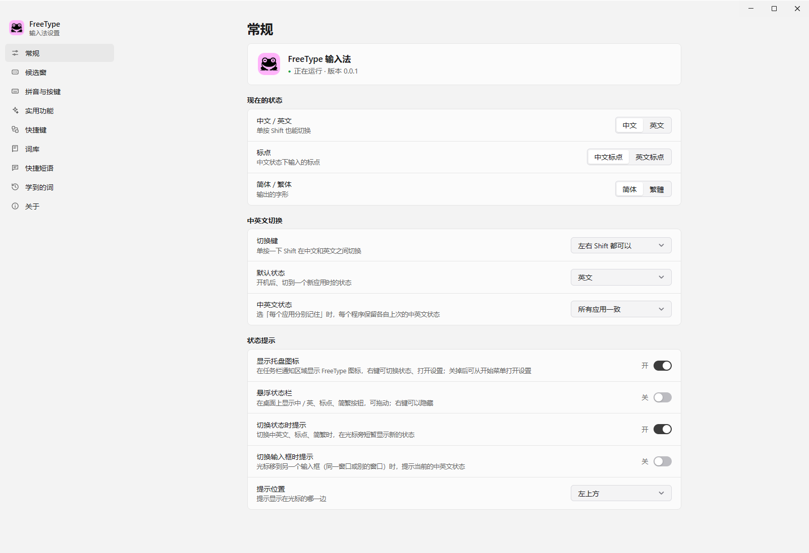
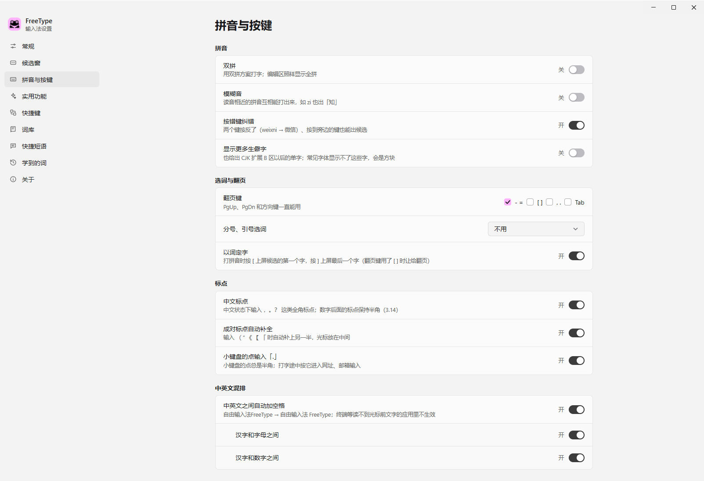
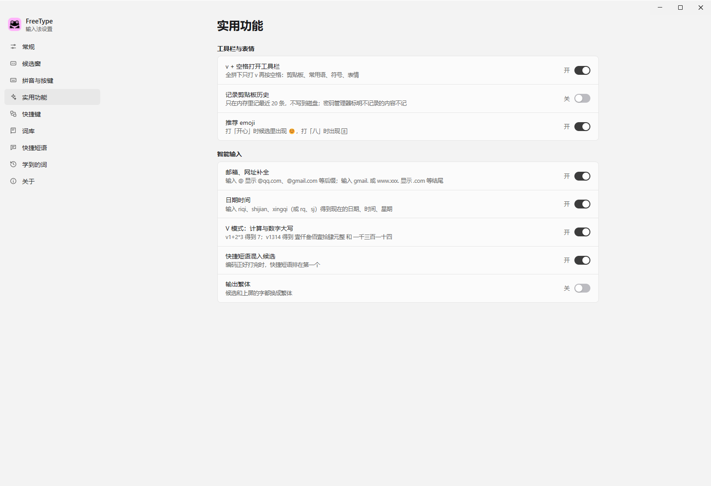
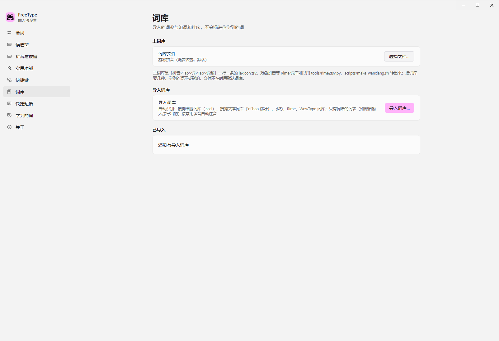
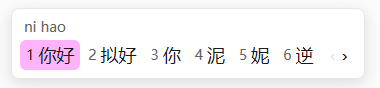
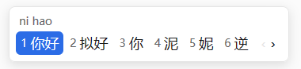
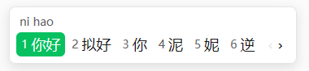
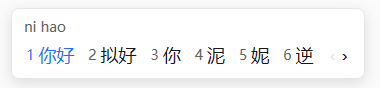

# FreeType

A local Windows Chinese input method. Your input stays on your computer.

[简体中文](README.md) | English

## What FreeType is

FreeType is a local Chinese input method. The input engine, dictionaries, and learning data run on your computer. Normal Chinese input needs no network. FreeType does not send the text that you type to a server.

FreeType is in pre-release validation and has no public release yet. See the [Windows validation scope](docs/WINDOWS.md#验证范围) for tested and untested behavior.

## Software preview

These images come from the FreeType installation on this computer. The General page is first.

<table>
<tr>
<td> General</td>
<td> Pinyin and Keys</td>
</tr>
<tr>
<td> Useful Features</td>
<td> Dictionaries</td>
</tr>
</table>

### Candidate window colors

The candidate window has four selected-candidate styles:

<table align="center">
<tr>
<td> Pink (default)</td>
<td> Blue</td>
</tr>
<tr>
<td> WeChat green</td>
<td> Sogou style (no color block)</td>
</tr>
</table>

## Why use FreeType

- **Local input. Your data stays on your computer.** The input engine, dictionaries, and learning data run locally. Normal Chinese input uses no network and sends no typed text to a server.
- **It learns your choices.** Your selected words and word pairs affect the candidate order.
- **It handles typing mistakes.** It can find the right word when nearby keys are pressed or two keys are reversed.
- **It includes open dictionaries.** Baishuang is the main dictionary, supplemented by Wanxiang and project hotwords for everyday language, online terms, and specialist vocabulary.
- **It moves your dictionaries with you.** It can import dictionaries and phrases from Shuishan, Sogou, Rime, and WowType.
- **It gives you input choices.** Use full pinyin, seven double-pinyin schemes, fuzzy pinyin, and several page keys.
- **It makes mixed text easier.** Use Chinese punctuation, paired punctuation, and spaces between Chinese and Latin text.
- **It keeps useful tools close.** Use quick phrases, symbols, emoji, date and time, and a calculator while you type.
- **It lets you set the candidate window.** Change its font, size, layout, number of candidates, and selected style.
- **It keeps your data on your computer.** Dictionaries, learning data, and settings use local files.

## Data and privacy

- Normal Chinese input runs on your computer.
- Dictionaries, settings, learning data, and quick phrases use local files.
- User data is stored in `%APPDATA%\FreeType`.
- Log files are stored in `%LOCALAPPDATA%\FreeType\logs`.
- Clipboard history is off by default.
- When enabled, clipboard history keeps the latest 20 items in memory.
- A learning backup contains personal input habits. Do not share it in public.
- Update checks connect to GitHub, and downloads use its release asset servers. Automatic updates are off by default. Update requests do not include typed text or learning data.

## System requirements

FreeType supports Windows 10/11 x64.

After you install or update FreeType, reopen applications that were already running.

## Common questions

### I can type letters only

1. Press Shift once to switch to Chinese.
2. Check that the input method button shows “中”.
3. Open FreeType Settings and check that the input service is running.

### The candidates are hard to read

Open **FreeType Settings → Candidate Window**. Change the font, font size, layout, or selected style.

### I want one word to appear first

Choose the word more often. FreeType learns your choices. You can also add the word in **Learned Words**.

### I want to use my own dictionary

Open **FreeType Settings → Dictionaries** and select the dictionary file. FreeType shows an import report for Sogou, Rime, and other supported formats.

### I want to save my input habits

Open **FreeType Settings → Learned Words** and click **Export**. After you move to another computer or reinstall FreeType, click **Import**.

## More information

- [Detailed Windows guide](docs/WINDOWS.md)
- [Configuration](docs/CONFIG.md)
- [Input method documentation](docs/README.en.md)

FreeType is based on [WowType](https://github.com/Gloridust/WowType). The Windows settings window and tray program use [mygo](https://github.com/egoist/mygo).

## License

FreeType selects [Apache-2.0](third_party/licenses/Apache-2.0-LICENSE.txt) for this code distribution. WowType's original `MIT OR Apache-2.0` dual license is preserved. See [third-party sources and licenses](third_party/README.md) for the authorization record.

Dictionaries, language models, icons, and other third-party components keep their own licenses; bundling them does not relicense them under Apache-2.0. See the [third-party notices](third_party/NOTICE.md) for license texts, attribution, and corresponding source.
