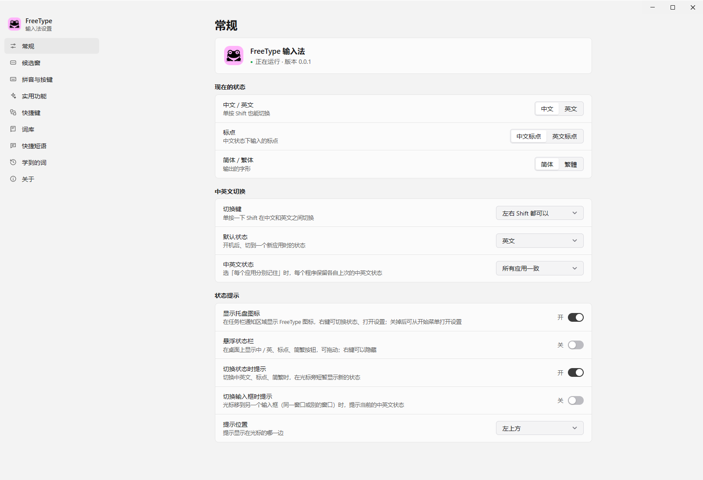
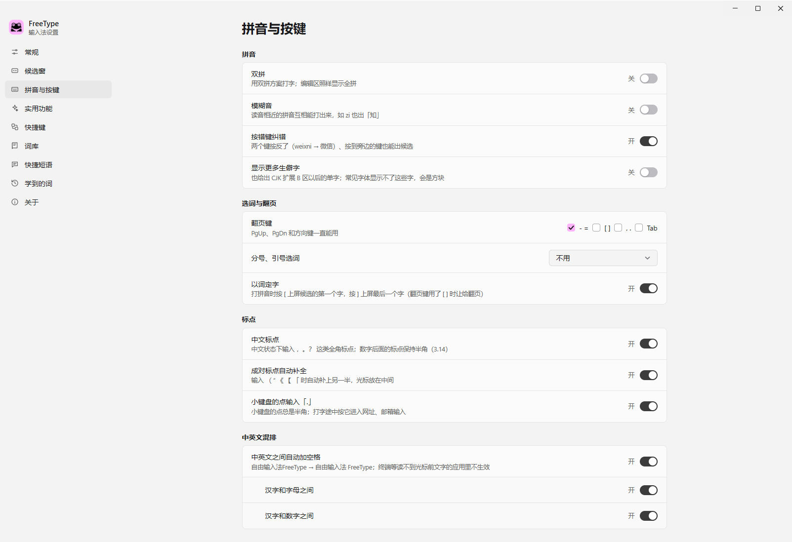
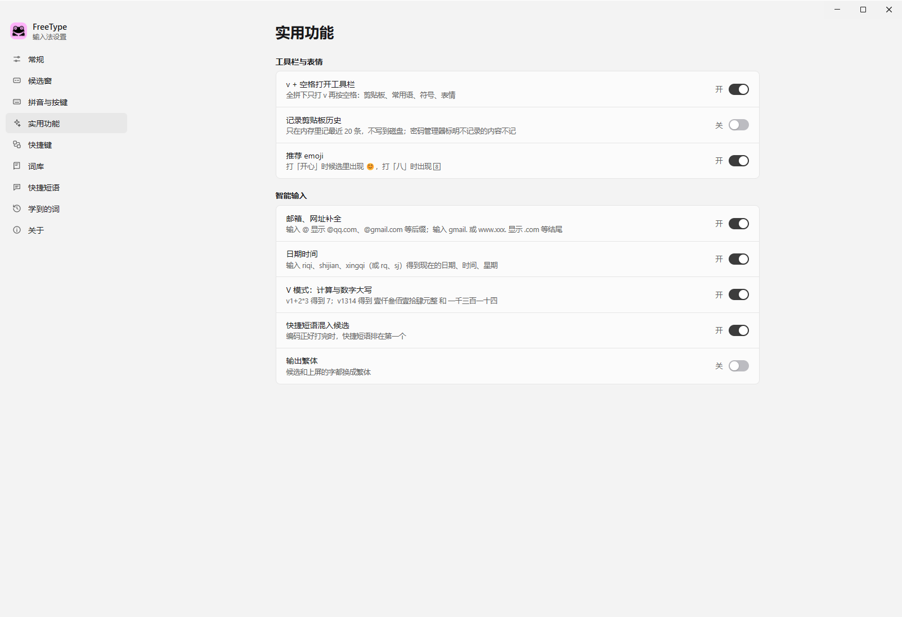
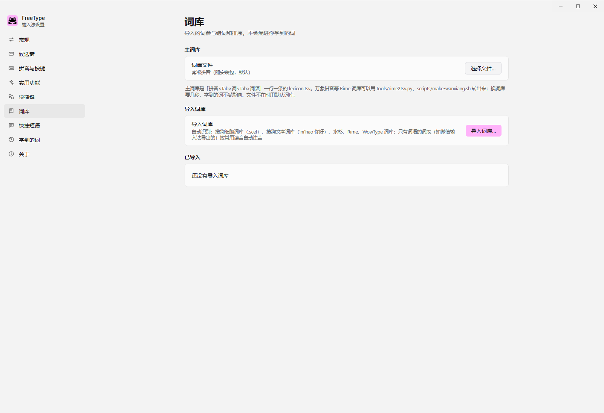

# FreeType

本地运行、不联网传输数据的 Windows 中文输入法

[English](README.en.md) | 简体中文

## FreeType 是什么

FreeType 是一个本地中文输入法。输入引擎、词库和学习记录都在本机运行。普通中文输入不需要网络，也不会把正在输入的内容发送到服务器。

## 软件预览

下面的图片来自本机安装版 FreeType。常规页放在第一张。

<table>
<tr>
<td> 常规</td>
<td> 拼音与按键</td>
</tr>
<tr>
<td> 实用功能</td>
<td> 词库</td>
</tr>
</table>

### 候选窗颜色

候选窗支持四种选中样式：

<table>
<tr>
<td> 粉色（默认）</td>
<td> 蓝色</td>
</tr>
<tr>
<td> 微信绿</td>
<td> 搜狗样式（无底色块）</td>
</tr>
</table>

## 为什么使用 FreeType

- **本地输入，数据留在电脑上**：输入引擎、词库和学习记录在本机运行。普通中文输入不联网，不向服务器发送正在输入的内容。
- **越用越顺手**：它会根据你的选词和常用词搭配调整候选顺序。
- **打错也能继续**：按错相邻键、两个键顺序反了，也能找到正确候选。
- **词库容易迁移**：可以导入水杉、搜狗、Rime、WowType 等格式的词库和短语。
- **输入方式灵活**：支持全拼、七种双拼方案、模糊音和多种翻页键。
- **中文排版更自然**：支持中文标点、成对标点和中英文自动加空格。
- **常用内容随时可用**：快捷短语、符号、emoji、日期时间和计算器都可以在输入时使用。
- **设置清楚**：候选窗的字体、字号、方向、数量和颜色都可以调整。
- **数据在自己的电脑上**：词库、学习记录和设置保存在本机。

## 数据和隐私

- 普通中文输入在本机完成。
- 词库、设置、学习记录和快捷短语保存在本机。
- 用户数据目录是 `%APPDATA%\FreeType`。
- 日志目录是 `%LOCALAPPDATA%\FreeType\logs`。
- 剪贴板历史默认关闭。
- 打开剪贴板历史后，最多保留最近 20 条，并保存在内存中。
- 学习备份包含个人输入习惯。请不要公开分享。

## 系统要求

FreeType 支持 Windows 10/11 x64。

安装或更新后，请重新打开已经运行的应用。

## 常见问题

### 只能输入英文字母

1. 单按 Shift，切回中文状态。
2. 检查任务栏的输入法按钮是否显示“中”。
3. 打开 FreeType 设置，检查输入法服务是否正在运行。

### 候选窗看不清

打开“FreeType 设置 → 候选窗”，更换字体、字号、排列方向或选中样式。

### 想让某个词排在前面

多次选择这个词。FreeType 会学习你的选择。也可以在“学到的词”中手动添加词语。

### 想使用自己的词库

打开“FreeType 设置 → 词库”，选择词库文件。导入搜狗、Rime 或其他支持的格式时，FreeType 会显示导入结果。

### 想保存输入习惯

打开“FreeType 设置 → 学到的词”，点击“导出”。换电脑或重新安装后，再点击“导入”。

## 相关文档

- [Windows 版详细说明](docs/WINDOWS.md)
- [配置说明](docs/CONFIG.md)
- [输入法技术文档](docs/README.md)

FreeType 基于 [WowType](https://github.com/Gloridust/WowType)。Windows 设置窗口和托盘程序使用 [mygo](https://github.com/egoist/mygo)。
