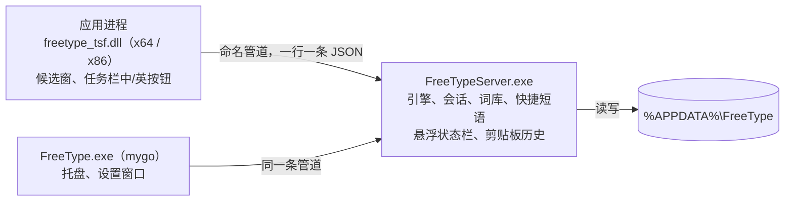

# Windows 版

FreeType 的 Windows 版由三部分组成：每个应用里加载的输入法 DLL、常驻的服务进程，以及用 mygo 写的托盘与设置程序。输入规则、词库和学习都复用 WowType 的 Rust 核心（`core/`）。

**状态：测试版 0.0.1。** 自动测试覆盖核心、服务进程、管道、DLL 加载和设置界面；在真实应用里打字的桌面验收尚未完成，见文末「验证范围」。

## 结构



- **输入法 DLL**（`windows/tsf`）：TSF 文本服务。把按键翻成键码交给服务进程，按应答组字、上屏，在光标下方画候选窗，在任务栏显示「中 / 英」按钮。服务进程连不上或 1.5 秒没应答时不吃键，应用照常收到按键，并记进日志 `tsf.log`；连接断了（服务进程重启过）会马上重连再发一次。
- **服务进程**（`windows/server`）：只有一个，常驻引擎（加载词库需要 1.5–7 秒、几百 MB 内存，不能放进每个应用）。每条管道连接一个输入会话。它还画桌面上的悬浮状态栏、在设置打开时记录剪贴板历史。处理请求时出错会写日志、重置那一个输入框，服务进程不退出。
- **托盘与设置**（`windows/app`）：mygo v0.9.0 原生界面。开机以 `--background` 启动，只放托盘图标并确保服务进程在跑。
- **协议**（`windows/protocol`）：管道消息定义，DLL、服务进程共用；设置程序在 `windows/app/protocol.go` 里有同样的结构（必须列全设置字段，见文件说明）。

管道名为 `\\.\pipe\FreeType-<当前用户 SID>`。访问控制允许当前用户、SYSTEM 和应用容器读写，完整性标签为低，商店应用和浏览器沙箱里的输入法也能连上。

## 中英文状态

- 中英文只由 FreeType 自己管，状态显示在任务栏按钮、悬浮状态栏和光标旁的提示里。
- 不看系统的「键盘打开 / 关闭」状态：有的应用自己建 TSF 线程时这个状态是「关闭」，`Ctrl+空格` 也会把它关掉，以前因此会一声不响地只出字母。现在激活和换输入框时把它设回「打开」。
- 只有应用说明这里不用输入法（密码框、禁用输入法的窗口）时才不接管按键。
- 单按 Shift 才切换：按下到松开之间按了别的键、按着 Ctrl / Alt / Win、点过或按着鼠标（Shift+点击选文字）、按住超过 0.6 秒都不算。能在设置里选只用左边或右边的 Shift，或者不用 Shift。
- 中英文状态可以所有应用一致，也可以每个应用分别记住；新应用用设置里的默认状态。

## 输入行为

| 操作 | 结果 |
| --- | --- |
| 单按 Shift | 切换中文 / 英文；切到英文时编辑区的字母原样上屏；光标旁提示「中」或「英」 |
| 字母 | 中文状态下进入编辑区；大写锁定时原样交给应用 |
| 空格、数字 | 选当前候选 / 第几个候选；分号、引号可设为选第 2、3 个 |
| 回车 | 编辑区的字母原样上屏 |
| 标点 | 没在组字：转成中文标点（数字后面保持半角，引号左右交替）；组字时：先上屏当前候选，再上屏标点 |
| `（` `“` `《` `【` `「` | 成对标点自动补全：补上另一半，光标停在中间（可关） |
| `-` `=`、PgUp PgDn | 翻页（`[ ]`、`, .`、Tab 可在设置里加上） |
| ← →、↓ | 移动候选；横排时 ↓ 展开 6 列的候选面板 |
| `[` `]` | 以词定字：上屏候选的第一个 / 最后一个字 |
| Ctrl+Delete、长按候选、右键候选 | 删除这个学错的词的记忆（词库本来的词回到原来的位置） |
| 鼠标点候选、点 ‹ › | 选词、翻页；鼠标停在上面是手形指针 |
| 右键候选窗 | 菜单：删除记忆、打开设置 |
| Esc | 清空编辑区 |

### 工具栏和表情面板

全拼下只打 `v` 再按空格打开工具栏：剪贴板、常用语（快捷短语）、符号、表情。符号和表情可以打拼音或英文搜索，最近用过的表情排在前面。数字选、方向键移动、空格或回车上屏、退格先删搜索词再回上一层、Esc 关闭；带 Ctrl、Alt、Win 的键关掉面板交给应用。表情面板也能用快捷键或任务栏按钮的菜单打开。

剪贴板历史默认关，在设置「实用功能」里打开。只在内存里记最近 20 条，不写到磁盘；复制时标了「不进剪贴板历史」（`CanIncludeInClipboardHistory` 为 0）或「监视程序不处理」的内容（常见密码管理器会标）不记。

### 邮箱、网址补全（照搜狗输入法）

- 打 `@`：候选是常用邮箱后缀（`@qq.com`、`@163.com`、`@gmail.com`、`@outlook.com` 等），接着打字母只留对得上的；打拼音途中打 `@` 也一样（`abc@` → `abc@qq.com`）。
- 打 `gmail`、`github`、`www.baidu` 这类网站名、英文单词后按句号：编辑区是 `gmail.`，候选给 `gmail.com`、`gmail.cn` 等结尾。普通拼音后的句号照常是「。」。
- 第一个候选是原样的输入。编辑区里数字是正文，用方向键或鼠标挑选，空格上屏光标处的，回车原样上屏。
- 小键盘的点：没在打字时直接上屏半角「.」；打字途中按它进入上面的补全。

### 其余

- V 模式：`v1+2*3` 得到 7；`v1314` 得到「壹仟叁佰壹拾肆元整」和「一千三百一十四」。
- 日期时间（riqi、shijian、xingqi、rq、sj）、emoji 推荐、学习：与 WowType 的会话接口一致，见 [ABI.md](ABI.md) 和 [USAGE.md](USAGE.md)。
- 中英文之间自动加空格（默认关）：上屏前看光标前一个字；DLL 在没在组字时把光标前的几个字一起发给服务进程。
- 默认不出 CJK 扩展 B 区以后的生僻单字（常见字体显示不了），设置里能打开。
- 主词库可以换成自己的 `lexicon.tsv`（设置「词库」页，对应 WowType 的 `Lexicon=`）：万象拼音等 Rime 词库用 `tools/rime2tsv.py`、`scripts/make-wanxiang.sh` 转出来。服务进程在后台重新载入，几秒后生效；文件不在时用默认的雾凇词库。WowType 的发布页目前没有现成的万象词库包，所以不提供一键下载。
- 可选快捷键（默认都不用，免得占用应用里同样的快捷键）：表情面板、中英文标点、简繁切换、`Ctrl+空格` 切换中英文。
- 语音输入和中英互译在 Windows 版不提供。

### 状态提示（照水杉输入法）

- **悬浮状态栏**：桌面右下角一小条，按钮依次是中 / 英、中英文标点、简 / 繁、设置；左边的握把能拖动，位置记住；右键能隐藏；能设成一会儿不用就收起。
- **切换状态时提示**：切换中英文、标点、简繁时，在光标旁短暂显示新的状态。
- **切换输入框时提示**（默认关）：光标移到另一个输入框时，提示当前的中英文状态。
- 提示放在光标的哪一边（六个方向）可以选。
- 任务栏的输入法按钮显示「中」或「英」，左键切换，右键菜单。

### 候选窗

字体默认是 Microsoft YaHei，设置里能换成系统里的任何字体，能改字号、每页个数和横排 / 竖排，设置页有预览。应用一时给不出光标位置（浏览器类应用打字时还没排好版）时，候选窗先放在上一次的位置或系统记的插入符处，排好版后再挪过去。

## 水杉输入法格式兼容

设置程序的「词库」「快捷短语」页可以导入、导出 [msime-windows](https://github.com/metasequoiaime/msime-windows) 的批量文件。实现只照公开的文件格式写在 `core/src/msime.rs`，没有使用水杉的代码或词库数据。

| 内容 | 每行格式 | 说明 |
| --- | --- | --- |
| 词库 | `词语<Tab>拼音[<Tab>权重]` | 拼音写成 `ni'hao`、`ni hao` 或 `nihao` 都可以；`#` 开头的行和 `---` 到 `...` 之间的 YAML 头跳过；权重空着或含 `=` 时取 10000 |
| 快捷短语 | `编码<Tab>短语[<Tab>权重]` | 编码只能是英文字母，不分大小写；短语里的换行、Tab、反斜杠写成 `\n`、`\t`、`\\`；权重默认 10，同一编码权重大的在前 |

- 导入的词库存为 `dicts\<名字>.txt`，参与组词和排序，不写进学到的用户词。
- 快捷短语在输入正好等于编码时排在候选第一位（对应水杉的「快捷短语混入候选」），可在设置里关闭。
- 导出的文件可以再导入水杉输入法。

与水杉的差异：

- 没有 Shift+K 的快捷短语前缀查询模式。
- 只写词语、不写拼音的行不会自动注音，导入时跳过并报告行号。
- 快捷短语文件里 `#` 开头的行当注释跳过；写了 Tab 但权重为空的行取默认权重（水杉对这两种行报错）。

## 用户数据

固定在 `%APPDATA%\FreeType`，覆盖安装和卸载都保留：

| 文件 | 内容 |
| --- | --- |
| `config.json` | 设置 |
| `quick_phrases.txt` | 快捷短语（水杉格式） |
| `dicts\*.txt` | 导入的词库（水杉格式） |
| `user.tsv`、`history.tsv` | 学到的词和输入习惯，每 30 秒及退出前保存；删除记忆后马上保存 |
| `emoji-recent.txt` | 最近用过的表情 |
| `statusbar.txt` | 悬浮状态栏的位置 |
| `wetype
lrgpt2_nnlm.bin` | 可选：微信输入法的神经语言模型（用户自己放进来，见 [CONFIG.md](CONFIG.md#数据文件)），有它整句更准 |

设置程序的「学到的词」页能搜索、逐个删除、导出和全部清空学到的词。

`%LOCALAPPDATA%\FreeType` 放词库快照缓存和日志：

| 日志 | 内容 |
| --- | --- |
| `logs\server.log` | 服务进程：启动、词库载入用时、退出、内部错误 |
| `logs	sf.log` | 输入法 DLL：连不上服务进程、没应答、连接断开（带程序名和进程号，同一种事 30 秒内只记一次） |

### 只能打出字母时

1. 看任务栏输入法按钮或悬浮状态栏是不是「英」；单按 Shift 切回中文。
2. 看 `tsf.log` 里有没有这个程序的「连不上服务进程」「服务进程没有应答」，以及 `server.log` 里的「内部错误」。
3. 在设置「常规」里看服务是否「正在运行」。服务进程不在时，下一次按键会尝试把它启动起来。

## 安装器

`output/release/FreeType-0.0.1-Setup.exe` 由 mygo 生成的 NSIS 安装器，按当前用户安装到 `%LOCALAPPDATA%\Programs\FreeType`。安装钩子见 `windows/app/installer.nsh`：

1. 升级前让旧的服务进程保存后退出，关闭托盘程序。
2. 弹出一次管理员授权，运行 `bin\FreeTypeServer.exe --register-tsf`：把 x64、x86 两份 DLL 和图标复制到 `Program Files\FreeType`、`Program Files (x86)\FreeType`，注册 COM 类和简体中文输入法配置，并在 `HKLM\SOFTWARE\FreeType` 记下服务进程位置。DLL 被占用时先改名，重启后删除旧文件。
3. 把 FreeType 加进当前用户的输入法列表，写入开机启动项，启动托盘程序。

安装器的文字跟随系统显示语言：简体中文、繁体中文或英文（其他语言用简体中文）。语言目录在 `windows/app/locales`，`catalog_gen.go` 由 `go tool mygo generate` 生成。

取消管理员授权时安装器会提示，输入法不可用；再运行一次安装程序即可重试。卸载时反向执行：注销输入法、移出输入法列表、删除开机启动项，保留用户数据。

## 构建

需要：Windows 10/11 x64、Visual Studio 2022 或更新版本的 C++ 生成工具与 Windows SDK、Python 3.11 与 Pillow、Git。Rust 和 Go 1.27.3 可以放在 `.local\toolchains`（不入库），构建脚本优先使用那里的版本。

1. 生成词库数据（rime-ice + 词级语言模型，约 70 MB，放 `.local\data`）：

   ```bash
   git clone --depth 1 https://github.com/iDvel/rime-ice.git .local/data-src/rime-ice
   bash scripts/make-data.sh .local/data-src/rime-ice .local/data
   ```

   脚本调用 `python3`。Windows 上它可能是应用商店的占位程序，需要让 `python3` 指向真正的 Python。

2. 构建固定测试安装器：

   ```powershell
   powershell -ExecutionPolicy Bypass -File windows\build.ps1
   ```

   脚本先跑全部测试，再构建服务进程、两种架构的 DLL 和 mygo 程序，生成安装器、`.sha256` 和 `build-info.json`。`build-info.json` 记录内部构建号、源码树（`git write-tree` 的结果）、工具链版本、组件和数据的 SHA-256。mygo 首次打包会下载 NSIS 3.13 到 `%LOCALAPPDATA%\mygo` 并校验摘要。

单独运行测试：

```powershell
cargo test -p wowtype-core --no-default-features
cargo test -p freetype-protocol -p freetype-server -p freetype-tsf
cd windows\app; go vet ./...; go test ./...
```

`freetype-server` 的端到端测试会以独立实例名启动真的服务进程（环境变量 `FREETYPE_INSTANCE`），不影响正在使用的输入法。

## 验证范围

已自动验证：

- Rust 核心在 Windows 上的全部测试，以及水杉格式读写、导入词库参与候选、按显示序号删除记忆、清空学习记录。
- 服务进程：按键规则、中英切换（左右 Shift、按应用记忆、默认状态）、标点（数字后半角、引号交替、成对补全）、工具栏、表情面板与最近表情、邮箱 / 网址补全、小键盘的点、快捷键、长按删除记忆、自动加空格、学到的词的列出 / 删除 / 清空、状态栏通知、按键预判缓存；经命名管道的端到端打字、导入和退出。
- 输入法 DLL：导出函数齐全；不注册直接载入时类工厂能建出文本服务，释放后可以卸载；按键翻译、单按 Shift 判定（含 Ctrl / 鼠标）、左右 Shift、提示位置。
- 设置界面：在无窗口测试中切换开关并整份保存设置、模糊音分组、快捷键、导入词库并显示报告、快捷短语增删和搜索、学到的词的搜索、删除和清空、打开文件夹；每一页的浅色、深色渲染图。

尚未验证（需要在测试机上安装后人工检查）：

- 安装器的语言（简体中文、繁体中文、英文按系统显示语言选择）、管理员授权、TSF 注册、加入输入法列表和卸载。
- 在记事本、浏览器、Office、水杉设置页这类自带 TSF 文本框的应用、商店应用、管理员进程和 32 位应用里实际打字；候选窗位置、长按和右键菜单、任务栏按钮、悬浮状态栏、剪贴板历史与高 DPI 显示。
