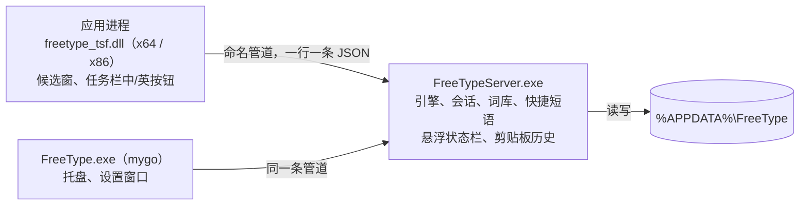

# Windows 版

FreeType 的 Windows 版由三部分组成：每个应用里加载的输入法 DLL、常驻的服务进程，以及用 mygo 写的托盘与设置程序。输入规则、词库和学习都复用 WowType 的 Rust 核心（`core/`）。

**状态：测试版 0.0.1。** 自动测试覆盖核心、服务进程、管道、DLL 加载和设置界面；在真实应用里打字的桌面验收尚未完成，见文末「验证范围」。

## 结构



- **输入法 DLL**（`windows/tsf`）：TSF 文本服务。把按键翻成键码交给服务进程，按应答组字、上屏，在光标下方画候选窗，在任务栏显示「中 / 英」按钮。服务进程连不上或 1.5 秒没应答时不吃键，应用照常收到按键，并记进日志 `tsf.log`；连接断了（服务进程重启过）会马上重连再发一次。
- **服务进程**（`windows/server`）：只有一个，常驻引擎（加载词库需要 1.5–7 秒、几百 MB 内存，不能放进每个应用）。每条管道连接一个输入会话。它还画桌面上的悬浮状态栏、在设置打开时记录剪贴板历史。处理请求时出错会写日志、重置那一个输入框，服务进程不退出。
- **托盘与设置**（`windows/app`）：mygo v0.9.0 原生界面。开机以 `--background` 启动，只放托盘图标并确保服务进程在跑。
- **协议**（`windows/protocol`）：管道消息定义，DLL、服务进程共用；设置程序在 `windows/app/protocol.go` 里有同样的结构（必须列全设置字段，见文件说明）。

管道名为 `\\.\pipe\FreeType-<当前用户 SID>`。访问控制允许当前用户、SYSTEM 和应用容器读写，完整性标签为低，商店应用和浏览器沙箱里的输入法也能连上。

服务端逐次核对系统提供的客户端身份，不信任客户端自报的应用名。低完整性进程和应用容器只能发送输入及状态请求，不能读写配置、批量读取学习记录、导入导出文件或关闭服务。管理请求限当前用户或 SYSTEM 的非应用容器、中等及以上完整性客户端。

## 中英文状态

- 中英文只由 FreeType 自己管，状态显示在任务栏按钮、悬浮状态栏和光标旁的提示里。
- 不看系统的「键盘打开 / 关闭」状态：有的应用自己建 TSF 线程时这个状态是「关闭」，`Ctrl+空格` 也会把它关掉，以前因此会一声不响地只出字母。现在激活和换输入框时把它设回「打开」。
- 只有应用说明这里不用输入法（密码框、禁用输入法的窗口）时才不接管按键。
- 单按 Shift 切换，和常见输入法一样：按下到松开之间没有按别的键就切换，按多久都算；只有和 Ctrl / Alt / Win 一起按（如 Ctrl+Shift 切换键盘布局）不算。能在设置里选只用左边或右边的 Shift，或者不用 Shift。系统第一次报这次松开时就切换，并且不吃掉这个键：浏览器内核的程序（Electron、Chrome）对同一次松开会问两遍，应用也照常收到 Shift 松开。
- 中英文状态可以所有应用一致，也可以每个应用分别记住；新应用用设置里的默认状态。

## 输入行为

| 操作 | 结果 |
| --- | --- |
| 单按 Shift | 切换中文 / 英文；切到英文时编辑区的字母原样上屏；光标旁提示「中」或「英」 |
| 字母 | 中文状态下进入编辑区；大写锁定时原样交给应用 |
| 空格、数字 | 选当前候选 / 第几个候选；分号、引号可设为选第 2、3 个 |
| 回车 | 编辑区的字母原样上屏 |
| 标点 | 没在组字：转成中文标点（数字后面保持半角，引号左右交替）；组字时：先上屏当前候选，再上屏标点 |
| `（` `“` `《` `【` `「` | 成对标点自动补全：补上另一半，再给应用按一下 ←，光标停在中间（可关）。← 等上屏结束、Shift / Ctrl / Alt / Win 都松开以后才发（最多等 2 秒）；这期间换了输入框或又按了别的键就不发 |
| `-` `=`、PgUp PgDn | 翻页（`[ ]`、`, .`、Tab 可在设置里加上） |
| ← →、↓ | 移动候选；横排时 ↓ 展开 6 列的候选面板 |
| `[` `]` | 以词定字：上屏候选的第一个 / 最后一个字 |
| Ctrl+Delete、长按候选、右键候选 | 删除这个学错的词的记忆（词库本来的词回到原来的位置） |
| 鼠标点候选、点 ‹ › | 选词、翻页；鼠标停在上面是手形指针 |
| 右键候选窗 | 菜单：删除记忆、打开设置 |
| Esc | 清空编辑区 |

### 工具栏和表情面板

全拼下只打 `v` 再按空格打开工具栏：剪贴板、常用语、符号、表情。工具栏的「常用语」只显示在设置「常用语」页保存的内容；快捷短语通过输入完整编码选用。符号和表情可以打拼音或英文搜索，最近用过的表情排在前面。数字选、方向键移动、空格或回车上屏、退格先删搜索词再回上一层、Esc 关闭；带 Ctrl、Alt、Win 的键关掉面板交给应用。表情面板也能用快捷键或任务栏按钮的菜单打开。

剪贴板历史默认关，在设置「实用功能」里打开。只在内存里记最近 20 条，不写到磁盘；复制时标了「不进剪贴板历史」（`CanIncludeInClipboardHistory` 为 0）或「监视程序不处理」的内容（常见密码管理器会标）不记。

### 邮箱、网址补全（照搜狗输入法）

- 打 `@`：候选是常用邮箱后缀（`@qq.com`、`@163.com`、`@gmail.com`、`@outlook.com` 等），接着打字母只留对得上的；打拼音途中打 `@` 也一样（`abc@` → `abc@qq.com`）。
- 打 `gmail`、`github`、`www.baidu` 这类网站名、英文单词后按句号：编辑区是 `gmail.`，候选给 `gmail.com`、`gmail.cn` 等结尾。普通拼音后的句号照常是「。」。
- 第一个候选是原样的输入。编辑区里数字是正文，用方向键或鼠标挑选，空格上屏光标处的，回车原样上屏。
- 小键盘的点：没在打字时直接上屏半角「.」；打字途中按它进入上面的补全。

### 其余

- V 模式：`v1+2*3` 得到 7；`v1314` 得到「壹仟叁佰壹拾肆元整」和「一千三百一十四」。
- 日期时间（riqi、shijian、xingqi、rq、sj）、emoji 推荐、学习：与 WowType 的会话接口一致，见 [ABI.md](ABI.md) 和 [USAGE.md](USAGE.md)。
- 中英文之间自动加空格（默认开）：同时检查光标前文字与本次上屏文字的交界，以及本次文字内部的中英交界。汉字与字母、汉字与数字分别控制。已有空格、换行和制表符保留；应用读不到光标前文字时，只处理本次上屏内容。
- 默认不出 CJK 扩展 B 区以后的生僻单字（常见字体显示不了），设置里能打开。
- 主词库可以换成自己的 `lexicon.tsv`（设置「词库」页，对应 WowType 的 `Lexicon=`）：Rime 词库用 `tools/rime2tsv.py` 转换。服务进程在后台重新载入，几秒后生效；文件不在时恢复默认的白霜主词库、万象补充和项目热词。默认数据随安装包提供，不在运行时联网更新。
- 可选快捷键（默认都不用，免得占用应用里同样的快捷键）：表情面板、中英文标点、简繁切换、`Ctrl+空格` 切换中英文。

### 状态提示（照水杉输入法）

- **托盘图标**（默认开）：通知区域里的 FreeType 图标，右键可切换状态、打开设置；在设置「常规」里能关掉，关掉后从开始菜单打开设置。
- **悬浮状态栏**（默认关）：桌面右下角一小条，按钮依次是中 / 英、中英文标点、简 / 繁、设置；左边的握把能拖动，位置记住；右键能隐藏；能设成一会儿不用就收起。
- **切换状态时提示**（默认开）：切换中英文、标点、简繁时，在光标旁短暂显示新的状态。
- **切换输入框时提示**（默认关）：光标移到另一个输入框时，提示当前的中英文状态。
- 提示放在光标的哪一边（六个方向）可以选，默认左上方。
- 任务栏的输入法按钮显示「中」或「英」，左键切换，右键菜单。

### 候选窗

字体默认是 Microsoft YaHei，设置里能换成系统里的任何字体，能改字号、每页个数和横排 / 竖排，设置页有预览。应用一时给不出光标位置（浏览器类应用打字时还没排好版）时，候选窗先放在上一次的位置或系统记的插入符处，排好版后再挪过去。

## 水杉输入法格式兼容

设置程序的「词库」「快捷短语」页可以导入、导出 [msime-windows](https://github.com/metasequoiaime/msime-windows) 的批量文件，也能直接导入搜狗、微信输入法等的文件（见下一节）。实现只照公开的文件格式写在 `core/src/msime.rs`，没有使用水杉的代码或词库数据。

| 内容 | 每行格式 | 说明 |
| --- | --- | --- |
| 词库 | `词语<Tab>拼音[<Tab>权重]` | 拼音写成 `ni'hao`、`ni hao` 或 `nihao` 都可以；`#` 开头的行和 `---` 到 `...` 之间的 YAML 头跳过；权重空着或含 `=` 时取 10000 |
| 快捷短语 | `编码<Tab>短语[<Tab>权重]` | 编码只能是英文字母，不分大小写；短语里的换行、Tab、反斜杠写成 `\n`、`\t`、`\\`；权重默认 10，同一编码权重大的在前 |

- 导入的词库存为 `dicts\<名字>.txt`，参与组词和排序，不写进学到的用户词。
- 快捷短语在输入正好等于编码时排在候选第一位（对应水杉的「快捷短语混入候选」），可在设置里关闭。
- 导出的文件可以再导入水杉输入法。

与水杉的差异：

- 没有 Shift+K 的快捷短语前缀查询模式。
- 只写词语、不写拼音的行不会自动注音，导入时跳过并报告行号。
- 快捷短语文件里 `#` 开头的行当注释跳过；写了 Tab 但权重为空的行取默认权重（水杉对这两种行报错）。

## 导入别的输入法的词库和短语

导入时自动识别格式，统一存成水杉格式（`windows/server/src/dictfmt.rs`）。只照公开的格式说明实现，没有使用这些输入法或转换工具的代码。

| 文件 | 每行 / 结构 | 编码 |
| --- | --- | --- |
| 搜狗细胞词库 `.scel` | 二进制：词组数、拼音表、词和词频 | UTF-16LE |
| 搜狗文本词库 | `'ni'hao 你好` | GBK、UTF-16、UTF-8 都认 |
| 水杉、Rime 词库 | `你好<Tab>ni hao[<Tab>权重]` | 同上 |
| WowType 词库 | `ni hao<Tab>你好<Tab>词频` | 同上 |
| 只有词语的词表 | `你好` 一行一个 | 同上；按正在用的词库里的常用读音自动注音，多音字可能注错 |
| 快捷短语：搜狗自定义短语、微信输入法常用语导出 | `编码,位置=短语`（位置 1 排最前） | 同上 |
| 快捷短语：Rime | `短语<Tab>编码[<Tab>权重]` | 同上 |

微信输入法电脑版没有公开的词库导出格式；它能导出的是常用语（第三方工具导出为 `编码,位置=短语`），以及只有词语的词表，上面两种都能导入。导入报告里写明认出的格式和自动注音的条数。

「学到的词」页可以自己加词：填词语和拼音（拼音可以空着，按常用读音自动注音），加进用户词库后马上能打出来、排在前面。

英文词和中英混输词也能添加。纯英文词留空时使用原词的小写作为输入码；混输词填写实际输入码，例如 `datag → 打 tag`。显示和上屏遵守当前空格设置，删除与备份保留原始词条标识。

## 个人用词与混输学习

学习以实际选词为依据。分段选出「打」和 `tag` 后，整条词按 `datag` 保存，再输入 `datag` 可直接选择。英文候选也会学习；双拼、简拼的混输记录保留实际键位。短中文词和短混输词在分段组词后即可收录，长句和普通整词仍按选用次数收录，默认阈值为 3 次。

选词次数、最近使用时间和词搭配继续参与排序。同一输入码对应多个个人词时，也使用已有的热度衰减和上下文搭配。上屏时补出的中英空格不会切断刚选出的词与后一个词的搭配；换行不会被误当作词内空格。词条、次数与搭配在重启、学习备份和全部设置备份恢复后保留。

## 软件更新与项目信息

「关于」显示 FreeType 的输入能力、GitHub 仓库、问题反馈和许可入口。仓库与反馈按钮直接打开 `OUBIGFA/FreeType` 的真实地址。

「检查更新」读取已发布的 Windows 安装器。「自动更新」默认关闭，开启后会后台检查并下载新版本，下次启动 FreeType 时通过完整安装器更新；「立即更新」可手动下载和安装。更新复用成熟库并核对 GitHub 提供的 SHA-256，系统输入法组件继续使用既有安装器注册流程。实现、失败处理和验证范围见 [UPDATES.md](UPDATES.md)。

「更新安装后显示设置页」也在「关于 → 软件更新」，默认关闭。开启后，安装或更新完成时自动打开设置页。该选项随全部设置保存和备份，从开始菜单或托盘主动打开设置不受影响。

## 搜索设置与常用语

侧边栏底部的「搜索设置」可以搜索所有设置的名称、说明和关键词。点击结果后跳转到对应页面，并滚动到目标设置，保留原有样式。尚未启用的子选项也可定位，页面说明启用条件；搜索不会替用户改变开关。按 Enter 定位第一项，按 Esc 返回原页面。

「常用语」位于「快捷短语」后面。内容不需要编码，支持多行，可以添加、删除和搜索。导出为 `FreeType 常用语.json`，保留多行内容；导入接受同一 JSON 格式或 UTF-8 文本（一行一条），重复内容不重复添加。「替换现有的」启用时使用导入列表，否则合并现有内容。

## 一键备份和恢复全部设置

1. 在「常规」页末尾的「一键导入、导出」中，点击「导出…」，保存 `FreeType 全部设置.json`。
2. 需要恢复时点击「导入…」，选择备份。软件先校验文件并显示内容概况。
3. 确认「导入并替换」后，恢复备份时的设置和数据。导入会替换当前内容；需要保留当前内容时先导出。

备份包含全部输入设置、导入词库、自定义主词库文件、快捷短语、常用语、学到的词、选词次数、使用时间、词搭配、最近表情和悬浮状态栏位置。学习记录直接从运行中的引擎读取，不等待定时存盘。自定义主词库按内容迁移，恢复后保存在新的用户数据目录，不依赖原机器路径。悬浮状态栏位置在窗口下次创建时使用。

备份不包含安装程序、随安装包提供的默认词库、缓存、日志、临时剪贴板内容及用户另行安装的外部模型。文件使用 UTF-8 JSON，标识为 `format: "freetype-settings"`、`version: 1`。错误版本、无效记录和异常词库名称会使整份导入失败。写入中断时还原已替换文件，并报告错误。

## 备份和恢复学习记录

1. 打开设置的「学到的词」页，点原有的「导出…」按钮，保存为 `FreeType 学习备份.json`。
2. 将备份保存在安装目录和用户数据目录之外。文件含有个人输入习惯，不要公开上传。
3. 重装后，在同一页点「导入…」，选择这份 JSON 文件。词条列表会立即刷新。

备份包含学到的词、手动添加的词、选词次数、最近使用时间和前后词搭配，也包含服务进程尚未定时存盘的记录。它不包含设置、导入的外部词库、快捷短语或剪贴板；这些内容沿用各自的保存和导出方式。

导入会合并现有学习记录，不先清空。已有词保留当前读音，词频取较大值；选词和搭配记录优先保留最近使用时间较新的记录，同一时间取较大次数。重复导入同一备份不会累加次数。格式或版本不正确时拒绝整份备份，不导入其中一部分。

文件使用 UTF-8 JSON，标识为 `format: "freetype-learning"`、`version: 1`。`words` 保存 `[拼音, 词语, 词频]`，`history` 保存 `[词语, 次数, 最近使用时间]`，`pairs` 保存 `[前词, 后词, 次数, 最近使用时间]`；时间单位为 Unix epoch 毫秒。

旧版「导出…」生成的 TXT 只有词表，无法恢复原来的选词次数和搭配；仍可在「词库」页导入词条。正常卸载会保留 `%APPDATA%\FreeType`，备份用于防止该目录被手动清理或用于换机恢复。

## 用户数据

固定在 `%APPDATA%\FreeType`，覆盖安装和卸载都保留：

| 文件 | 内容 |
| --- | --- |
| `config.json` | 设置 |
| `quick_phrases.txt` | 快捷短语（水杉格式） |
| `common_phrases.json` | 工具栏常用语，支持多行 |
| `main-lexicon.tsv` | 从全部设置备份恢复的自定义主词库 |
| `dicts\*.txt` | 导入的词库（水杉格式） |
| `user.tsv`、`history.tsv` | 学到的词和输入习惯，每 30 秒及退出前保存；删除记忆后马上保存 |
| `emoji-recent.txt` | 最近用过的表情 |
| `statusbar.txt` | 悬浮状态栏的位置 |
| `wetype
lrgpt2_nnlm.bin` | 可选：微信输入法的神经语言模型（用户自己放进来，见 [CONFIG.md](CONFIG.md#数据文件)），有它整句更准 |

设置程序的「学到的词」页能搜索、逐个删除、导出和全部清空学到的词。「常规」页的一键导入、导出可备份和恢复整个用户配置。

`%LOCALAPPDATA%\FreeType` 放词库快照缓存和日志：

| 日志 | 内容 |
| --- | --- |
| `logs\server.log` | 服务进程：启动、词库载入用时、退出、内部错误 |
| `logs	sf.log` | 输入法 DLL：连不上服务进程、没应答、连接断开（带程序名和进程号，同一种事 30 秒内只记一次） |

### 只能打出字母时

1. 看任务栏输入法按钮或悬浮状态栏是不是「英」；单按 Shift 切回中文。
2. 看 `tsf.log` 里有没有这个程序的「连不上服务进程」「服务进程没有应答」，以及 `server.log` 里的「内部错误」。
3. 在设置「常规」里看服务是否「正在运行」。服务进程不在时，下一次按键会尝试把它启动起来。

## 安装器

`output/release/FreeType-0.0.1-Setup.exe` 由 mygo 生成的 NSIS 安装器，按当前用户安装到 `%LOCALAPPDATA%\Programs\FreeType`。安装钩子见 `windows/app/installer.nsh`：

1. 升级前让旧的服务进程保存后退出，关闭托盘程序。
2. 弹出一次管理员授权，运行 `bin\FreeTypeServer.exe --register-tsf`：把 x64、x86 两份 DLL 和图标复制到 `Program Files\FreeType`、`Program Files (x86)\FreeType`，注册 COM 类和简体中文输入法配置，并在 `HKLM\SOFTWARE\FreeType` 记下服务进程位置。DLL 被占用时先改名，重启后删除旧文件。
3. 把 FreeType 加进当前用户的输入法列表，写入开机启动项，启动托盘程序。

安装器的文字跟随系统显示语言：简体中文、繁体中文或英文（其他语言用简体中文）。语言目录在 `windows/app/locales`，`catalog_gen.go` 由 `go tool mygo generate` 生成。

取消管理员授权时安装器会提示，输入法不可用；再运行一次安装程序即可重试。注册成功标记保存在本次安装器的私有临时目录。加入当前用户输入法列表失败时也会停止安装，不清除待更新记录。卸载时反向执行：注销输入法、移出输入法列表、删除开机启动项，保留用户数据。

安装目录另有 `THIRD-PARTY-NOTICES.txt` 和 `third-party/manifest.json`。后者列出随包许可、对应源码和摘要；详情见 [第三方声明](../third_party/NOTICE.md)。WowType 固定修订的 README 明确提供 MIT 或 Apache-2.0 选项，本次按 Apache-2.0 分发代码，并保留原文证据。词库、模型及其他组件仍遵循各自许可。

应用、服务、x64/x86 输入法 DLL 和安装器均带 Windows 产品名称、文件版本、产品版本、说明及原始文件名。固定测试包的字符串版本为 `0.0.1`、数值版本为 `0.0.1.0`；同版本不同构建仍用 `build-info.json` 的内部构建号、源码树和 SHA-256 区分，不靠改版本规避覆盖安装测试。

更新和卸载时，安装器使用同一准备步骤，只结束目标安装目录中的 FreeType 托盘和服务进程。服务进程会先收到保存学习记录并退出的请求；未退出的 FreeType 进程再被结束。无法结束时停止并报告原因，不继续操作文件。其他目录里的同名程序不受此步骤影响。

安装器不会关闭正在使用输入法的其他应用。已打开的应用可能仍在运行旧版 DLL；更新涉及 DLL 本身时，需关闭并重新打开相应应用才能确定用上新版，不要求重启 Windows。仅重新注册输入法或覆盖磁盘文件不会替换这些应用内存中的代码。

## 构建

需要：Windows 10/11 x64、Visual Studio 2022 或更新版本的 C++ 生成工具与 Windows SDK、Python 3.11 与 Pillow、Git。Rust 和 Go 1.27.4 可以放在 `.local\toolchains`（不入库），构建脚本优先使用那里的版本。本次 Windows 构建使用 Rust 1.99.1；Go 固定为 1.27.4，以包含标准库安全修复。

1. 生成默认数据（白霜完整主库、万象核心词库、项目热词和词级语言模型，放 `.local\data`）：

   ```powershell
   python -X utf8 tools/make_default_data.py
   ```

   输入修订、归档摘要及模型摘要固定在 `third_party/manifests/default-data.json`。下载使用 aria2-next；未加入 PATH 时，将 `ARIA2_NEXT` 设为其完整路径。已校验的快照会复用，不依赖浮动 `latest`。模型不变时复用现有 `words.lm`，也可以用 `--model` 指定本地文件，摘要必须匹配。

   同音同词保留白霜权重，万象只补缺词和额外读音；两库分别按既有引擎的词频量级归一化，最后合入项目热词。保留白霜主库引用的细胞词库，修正其 `extthot` 引用为实际的 `exthot`。两张大字表只补缺字，不参与常用组句。白霜 `corrections`、万象 `cuoyin` 依赖 Rime 的纠音提示，不纳入 FreeType。万象取字表、基础词、兼容读音、地名、名人和艺人六张默认核心表，不使用其程序代码或 `.gram` 模型。

   `MANIFEST.json` 记录修订、转换输入、词条数和输出摘要。`LICENSE` 包含 GPL-3.0、CC BY 4.0 与 CC BY-SA 4.0 文本；万象的许可范围和第三方声明也随数据保留。更新源修订后须重新生成并验收，不把新词覆盖率或排序改善当成未经测试的保证。

2. 构建固定测试安装器：

   ```powershell
   powershell -ExecutionPolicy Bypass -File windows\build.ps1
   ```

   脚本先校验默认数据与固定修订是否一致，再跑词库合并、核心、服务进程、DLL 和设置界面测试，随后构建服务进程、两种架构的 DLL 和 mygo 程序。打包前，`tools/make_third_party_notices.py` 归集完整许可及所需源码；缺原文、缺 MPL 对应源码或固定输入摘要不符时停止。NSIS 声明直接从固定源码归档提取，不依赖本机预先存在 NSIS。归档缓存在 `.local/third-party/`；首次取得这些输入也需要 `ARIA2_NEXT`。

   安装器生成后，脚本核对五个文件的版本资源、NSIS 与所附源码的版本一致性、随包声明及逐文件摘要，再使用一次性测试进程验证复制前的进程结束步骤。全部通过后才更新固定安装器、`.sha256` 和 `build-info.json`。构建记录包含内部构建号、源码树（`git write-tree` 的结果）、工具链版本、组件及数据摘要、白霜和万象修订、词条数、版本资源、声明清单摘要及未解决授权项。mygo 首次打包会下载 NSIS 3.13 到 `%LOCALAPPDATA%\mygo` 并校验摘要。

构建会先检查仓库索引，再运行仓库、数据和应用测试。源码快照只包含已跟踪文件的工作区内容和已暂存的新文件，不自动纳入其他未跟踪资料。构建目录内有未跟踪源码时先报错，需审阅并暂存后重试。构建前后必须得到相同的源码提交和源码树；不一致时不更新固定测试包。Rust 使用锁定依赖构建，Go 不允许在构建中改写模块清单。

默认构建仍生成 `output/release/FreeType-0.0.1-Setup.exe`。指定产品版本时，脚本复制已跟踪的应用源码到本次临时目录，只在副本中调整 mygo 配置和 NSIS 版本；Rust 资源与服务状态使用同一个构建版本。候选输出不会覆盖固定测试安装器：

```powershell
powershell -File windows/build.ps1 -Version 0.1.0
```

候选包及校验记录位于 `output/candidates/0.1.0/`。用户确认发布草稿后，从已批准标签的干净检出运行 `powershell -File windows/build.ps1 -Version 0.1.0 -ReleaseTag 0.1.0`，输出到 `output/releases/0.1.0/`。标签必须与版本和当前提交匹配，不能带未提交或未跟踪文件，不能使用 `-SkipTests`。命令本身不创建标签、不上传产物、不发布，也不执行真实安装验收；远端发布条件仍见 [发布流程](RELEASE.md)。

单独运行测试：

```powershell
cargo test -p wowtype-core --no-default-features
cargo test -p freetype-protocol -p freetype-server -p freetype-tsf
python -X utf8 tools/check_repo.py
python -X utf8 -m unittest discover -s tests/repository -v
python -X utf8 -m unittest discover -s tests/data -v
python -X utf8 -m unittest discover -s tests/windows -v
cd windows\app; go vet ./...; go test ./...
```

`freetype-server` 的端到端测试会以独立实例名启动真的服务进程（环境变量 `FREETYPE_INSTANCE`），不影响正在使用的输入法。

## 验证范围

安装、覆盖升级、UAC 取消、x64/x86 应用输入、卸载及数据保留的操作和通过条件见 [隔离环境验收清单](WINDOWS-ACCEPTANCE.md)。清单默认全部“未执行”，不能把文档存在或自动测试通过当作真实安装验收。

已自动验证：

- 发布资源：读取实际应用、服务、两种 DLL 及安装器的 Windows 版本资源；核对打包目录内的总声明、组件清单和许可/源码摘要。此项不运行安装器，最终安装结果仍需隔离验收。
- 学习备份：导出未存盘的词条和输入习惯，导入后存盘并重新载入；保留现有学习，重复导入不累加，拒绝损坏记录，报告读写失败；设置页的导出、导入、取消和错误提示。
- 安装和卸载准备：执行实际 NSIS 准备函数，先请求测试服务退出；保留其他目录的同名进程和同目录中的其他程序。一次性服务程序覆盖启用、禁用、注销及恢复失败；取消提权或缺少本次成功标记时，卸载停止，程序与启动项保留。旧标记不能冒充本次成功。测试替换提权边界并使用独立注册表键，不安装或注册真实输入法，也不代替真实 UAC 验收。
- 管道权限：真实低完整性客户端仍能输入中文，不能导出备份、读配置、读取或清空学习记录及关闭服务；普通客户端仍可导出。
- 文件与构建边界：原子导出保留相邻的用户文件，写入失败不遗留本次临时文件；源码快照不改动真实索引，拒绝未暂存的新构建输入和构建中的源码变化。
- Rust 核心在 Windows 上的全部测试，以及水杉格式读写、导入词库参与候选、按显示序号删除记忆、清空学习记录。
- 服务进程：按键规则、中英切换（左右 Shift、按应用记忆、默认状态）、标点（数字后半角、引号交替、成对补全）、工具栏、表情面板与最近表情、邮箱 / 网址补全、小键盘的点、快捷键、长按删除记忆、自动加空格、学到的词的列出 / 删除 / 清空、状态栏通知、按键预判缓存；经命名管道的端到端打字、导入和退出。
- 输入法 DLL：导出函数齐全；不注册直接载入时类工厂能建出文本服务，释放后可以卸载；按键翻译、单按 Shift 判定（含 Ctrl、同一次按键被重复询问）、左右 Shift、成对标点挪光标的时机、提示位置。
- 设置界面：在无窗口测试中切换开关并整份保存设置、默认值、模糊音分组、快捷键、候选窗预览随字体和每页个数变化、导入词库并显示报告、快捷短语增删和搜索、短语列表最多 12 行、学到的词的搜索、添加、删除和清空、打开文件夹；每一页的浅色、深色渲染图。
- 词库导入：搜狗细胞词库、搜狗文本词库（UTF-8、UTF-16、GBK）、水杉 / Rime / WowType 文本、只有词语的词表自动注音；快捷短语的搜狗 / 微信、Rime、水杉格式。

尚未验证（需要在测试机上安装后人工检查）：

- 安装器的语言（简体中文、繁体中文、英文按系统显示语言选择）、管理员授权、TSF 注册、加入输入法列表和卸载。
- 在记事本、浏览器、Office、水杉设置页这类自带 TSF 文本框的应用、商店应用、管理员进程和 32 位应用里实际打字；候选窗位置、长按和右键菜单、任务栏按钮、悬浮状态栏、剪贴板历史与高 DPI 显示。
