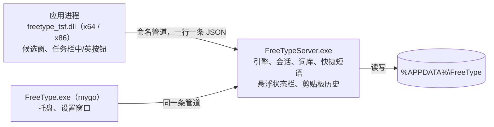

# Windows 版

FreeType 的 Windows 版由三部分组成：每个应用里加载的输入法 DLL、常驻的服务进程，以及用 mygo 写的托盘与设置程序。输入规则、词库和学习都复用 WowType 的 Rust 核心（`core/`）。

**状态：测试版 0.0.1。** 自动测试覆盖核心、服务进程、管道、DLL 加载和设置界面，详见文末「验证范围」。

## 结构



- **输入法 DLL**（`windows/tsf`）：TSF 文本服务。把按键翻成键码交给服务进程，按应答组字、上屏，在光标下方画候选窗，在任务栏显示「中 / 英」按钮。服务进程连不上或 1.5 秒没应答时不吃键，应用照常收到按键，并记进日志 `tsf.log`；连接、握手、断线重连和分块应答共用这一次期限。
- **服务进程**（`windows/server`）：只有一个，常驻引擎（加载词库需要 1.5–7 秒、几百 MB 内存，不能放进每个应用）。每条管道连接一个输入会话。它还画桌面上的悬浮状态栏、在设置打开时记录剪贴板历史。处理请求时出错会写日志、重置那一个输入框，服务进程不退出。
- **托盘与设置**（`windows/app`）：mygo v0.10.0 原生界面。开机以 `--background` 启动，只放托盘图标并确保服务进程在跑。
- **协议**（`windows/protocol`）：管道消息定义，DLL、服务进程共用；设置程序在 `windows/app/protocol.go` 里有同样的结构（必须列全设置字段，见文件说明）。

管道名为 `\\.\pipe\FreeType-<当前用户 SID>`。访问控制允许当前用户、SYSTEM 和应用容器读写，完整性标签为低，商店应用和浏览器沙箱里的输入法也能连上。

固定安装包在构建时生成 `data/lexicon.ftd`。它保留完整默认词库，复用现有 TSV 解析与词频估算，并用 `fst` 和 `memmap2` 保存压缩索引、进行只读文件映射。服务按需读取命中的词条，全拼、简拼、模糊音和上屏联想共用同一文件。安装或更新后第一次启动时完整核对索引与源词库的校验值，通过后把两个文件的大小和修改时间记在 `%LOCALAPPDATA%\FreeType\cache\lexicon.verified`；以后启动时两者都没变就只检查文件头和边界，不再整份读取约 300 MB 文件。文件被替换后会重新完整核对；原地损坏但修改时间不变的情况不会被发现。词级语言模型 `words.lm` 同样只读映射。做法参考 Rime 的静态词库部署与只读映射。[Rime 映射实现](https://github.com/rime/librime/blob/master/src/rime/dict/mapped_file.cc)

旧安装目录和自选 TSV 主词库仍使用现有载入入口。服务报告就绪前，后台线程会建好需要的模糊音索引；默认编译词库已经包含这份索引。`tests/windows/test_update_handoff.py` 使用完整随包词库，覆盖旧 TSV 首次载入、快照重启和编译词库，并验证模糊音开启、关闭时的首次与再次输入。

任务栏右键先排队到应用的消息循环，再显示原生菜单。参照小狼毫，菜单依附输入文档窗口，并使用 `TPM_NONOTIFY | TPM_RETURNCMD` 返回所选命令。菜单打开期间连续右键合并处理，候选窗和提示窗的隐藏计时器可以独立运行；文本服务停用时取消菜单。相关回归在私有桌面执行。[小狼毫语言栏实现](https://github.com/rime/weasel/blob/master/WeaselTSF/LanguageBar.cpp)

学习词在启动时批量载入，只重建一次索引。导入词库使用独立索引，正常选词学习不再连带重建导入数据。学习记录按经过的时间每 30 秒保存，持续输入或状态轮询不会推迟保存；每个学习文件完整写入并刷盘后才替换旧文件。切换主词库时，后台载入期间新增和删除的学习记录会接续到新引擎。

设置程序按顺序保存连续修改，旧应答不会覆盖较新的界面选择。管理请求最多等待 30 秒，超时后释放连接并显示错误；已经发送但未收到结果的修改不会自动重复执行，用户应刷新核对。输入法按键仍使用独立的 1.5 秒上限。全部设置备份只校验自定义词库格式，不额外构建查询索引。

服务进程报告就绪前，编辑区照常接收字母，候选窗显示「词库载入中」；载好后下一个键就给出候选。托盘程序最多等 60 秒。冷启动时设置窗口先显示；服务完成词库载入后自动刷新状态和设置，载入失败时显示错误。多次刷新或切换中英文时，较早的应答不会覆盖新的设置；读取设置失败会保留已有内容并显示提示。外部模型在载入时检查索引、偏移和全部浮点权重，拒绝损坏内容。

服务端逐次核对系统提供的客户端身份，不信任客户端自报的应用名。低完整性进程和应用容器只能发送输入及状态请求，不能读写配置、批量读取学习记录、导入导出文件或关闭服务。管理请求限当前用户或 SYSTEM 的非应用容器、中等及以上完整性客户端。

## 中英文状态

- 中英文只由 FreeType 自己管，状态显示在任务栏按钮、悬浮状态栏和光标旁的提示里。
- 不看系统的「键盘打开 / 关闭」状态：有的应用自己建 TSF 线程时这个状态是「关闭」，`Ctrl+空格` 也会把它关掉，以前因此会一声不响地只出字母。现在激活和换输入框时把它设回「打开」。
- 启用 `Ctrl+空格` 切换后，被系统截走的按键通过状态通知补发。等通知返回后再恢复「打开」；Windows 禁止在通知内写回，否则下一次按键只会打开系统状态。重复回调按消息时间去重，宿主漏报空格松开也不影响下一次切换。
- 只有应用说明这里不用输入法（密码框、禁用输入法的窗口）时才不接管按键。
- 单按 Shift 切换，和常见输入法一样：按下到松开之间没有按别的键就切换，按多久都算；只有和 Ctrl / Alt / Win 一起按（如 Ctrl+Shift 切换键盘布局）不算。能在设置里选只用左边或右边的 Shift，或者不用 Shift。系统第一次报这次松开时就切换，并且不吃掉这个键：浏览器内核的程序（Electron、Chrome）对同一次松开会问两遍，应用也照常收到 Shift 松开。
- 中英文状态可以所有应用一致，也可以每个应用分别记住；新应用用设置里的默认状态。
- 指定软件自动切换（设置「实用功能」页，默认关）：切入指定程序时切换一次，软件内部可手动切换；离开后恢复原模式，不覆盖普通程序的状态和全局记忆。快速切换时，过期的前台或后台焦点通知不会重新应用规则。
- Vim 模式（「实用功能 → Vim 模式」）：为 code.exe、gvim.exe 等添加规则后，空闲时单按 Esc 会切英文，同时把 Esc 交给编辑器。组字或联想中的第一次 Esc 仍只取消；释放后再按才切英文。组合键、长按重复和按键预判不切换。规则按程序匹配，同一程序的所有窗口都生效，终端内其他程序也会受影响；默认没有规则，独立于切入程序时的预设。

## 输入行为

| 操作 | 结果 |
| --- | --- |
| 单按 Shift | 切换中文 / 英文；切到英文时编辑区的字母原样上屏；光标旁提示「中」或「英」 |
| 字母 | 中文状态下进入编辑区；大写锁定时原样交给应用 |
| 空格、数字 | 选当前候选 / 第几个候选；分号、引号可设为选第 2、3 个 |
| 回车 | 编辑区的字母原样上屏并照常计入学习；达到阈值后可以进入用户词库 |
| 标点 | 没在组字：转成中文标点（数字后面保持半角，引号左右交替）；组字时：先上屏当前候选，再上屏标点 |
| `（` `“` `《` `【` `「` | 成对标点自动补全：补上另一半，再给应用按一下 ←，光标停在中间（可关）。← 等上屏结束、Shift / Ctrl / Alt / Win 都松开以后才发（最多等 2 秒）；这期间换了输入框或又按了别的键就不发 |
| `-` `=`、PgUp PgDn | 翻页（`[ ]`、`, .`、Tab 可在设置里加上） |
| ← →、↓ | 移动候选；横排时 ↓ 展开 6 列的候选面板 |
| ← →、Home End、Delete（「左右方向键」设为在拼音里移动光标时） | 在拼音中间移动光标、删除光标后的字母；↑ ↓ 改为选词，不再展开候选面板 |
| `[` `]` | 以词定字：上屏候选的第一个 / 最后一个字 |
| Ctrl+Delete、长按候选、右键候选 | 删除这个学错的词的记忆（词库本来的词回到原来的位置） |
| 鼠标点候选、点 ‹ › | 选词、翻页；鼠标停在上面是手形指针 |
| 右键候选窗 | 菜单：置顶、固定排位、删除记忆、打开设置。固定排位本机独立保存，不随学习备份或云同步 |
| Esc | 清空编辑区 |

### 工具栏和表情面板

全拼下只打 `v` 再按空格打开工具栏：剪贴板、常用语、符号、表情。工具栏的「常用语」只显示在设置「常用语」页保存的内容；快捷短语通过输入完整编码选用。符号和表情可以打拼音或英文搜索，最近用过的表情排在前面。数字选、方向键移动、空格或回车上屏、退格先删搜索词再回上一层、Esc 关闭；带 Ctrl、Alt、Win 的键关掉面板交给应用。表情面板也能用快捷键或任务栏按钮的菜单打开。

剪贴板历史默认关，在设置「实用功能」里打开。只在内存里记最近 20 条，不写到磁盘；复制时标了「不进剪贴板历史」（`CanIncludeInClipboardHistory` 为 0）或「监视程序不处理」的内容（常见密码管理器会标）不记。

### 邮箱、网址补全（照搜狗输入法）

- 打 `@`：候选是常用邮箱后缀（`@qq.com`、`@163.com`、`@gmail.com`、`@outlook.com` 等），接着打字母只留对得上的；打拼音途中打 `@` 也一样（`abc@` → `abc@qq.com`）。
- 打 `gmail`、`github`、`www.baidu` 这类网站名、英文单词后按句号：编辑区是 `gmail.`，候选给 `gmail.com`、`gmail.cn` 等结尾。普通拼音后的句号照常是「。」。
- 第一个候选是原样的输入。编辑区里数字是正文，用方向键或鼠标挑选，空格上屏光标处的，回车原样上屏。
- 小键盘的点：没在打字时直接上屏半角「.」；打字途中按它进入上面的补全。

### 长词前缀补全

默认开启，可在「实用功能 → 智能输入 → 长词前缀补全」关闭。全拼或双拼输入至少 4 个完整音节后，从正在使用的主词库、导入词库和个人词中补出一个更长的汉字词，例如 `zhonghuarenmin` →「中华人民共和国」、`chuangqianmingyue` →「床前明月光」。实际结果取决于词库内容和词频。

补全通常放在第二位，与普通候选一样显示；原首选保留，手动固定排位优先。首选是词库中的完整词时，补全匹配该词的字面前缀；首选是组句时，按完整读音查找。简拼、纠错和未打完的音节不触发。只返回词库里已有的长词，不扩写任意句子，也不联网。

选中后一次上屏完整词，并按完整读音学习，不把前缀存成完整词的输入码；补全候选不能在前缀编码下置顶或固定排位。此开关独立于上屏联想，随设置备份与同步保存。

整词有多个补全时，优先选择语言模型收录的完整词；只有未收录的备选时，用字级模型比较补出首字的上下文提升度，过滤缺乏支持的切词残片。按读音补诗句和专名、只有一个词库扩展时仍保留。每次只评估有限候选，不为每条长句运行完整神经推理；普通首选不变。

### 上屏联想

「上屏联想」默认关闭，在「实用功能 → 联想」中开启。数字键选词默认关闭，空格选词、双击空格和左右方向键默认开启。双击模式下，按一次空格照常输入；在同一位置紧接着按第二次，会用高亮的联想词替换刚输入的空格。关闭双击模式后，按一次空格即可选词。每次选词后可继续对新联想双击空格。

双击模式下，第一个空格立即显示在输入法的预编辑区；预编辑区是输入法暂时拥有、尚未正式上屏的文字。第二次空格将该编辑区整体替换为联想词，再一次性上屏。单次空格在双击间隔结束或继续输入时正式上屏；按退格则取消这个空格。双击间隔跟随 Windows 设置，并限制在 200–700 毫秒。

微信等 IMM32 输入框与 Chromium 系输入框使用同一套编辑区流程。联想选词不再发送模拟退格或后续提交按键，应用延迟处理键盘消息也不会删掉联想词的末字。切换输入框或收起联想时，尚未结束的单次空格只在原编辑区提交。

- 用拼音选的词上屏后，候选窗接着显示常跟在这个词后面的词（最多一页）。原样上屏的字母、标点后面不联想。
- 用 ← / → 移动高亮，再用空格选词；也可直接用鼠标点。开启数字键选词后，可用 1–9、0 直接选择对应的联想词。选中后继续联想。关闭子开关后，相应的按键照常输入或移动光标；左右键和组字时的设定独立，到两头时停住，不循环。
- 同一批联想用左右键换高亮时，窗口位置、尺寸和每个候选的点击区域保持不变，不使用应用此时迟报的光标位置重新排版。上屏后产生新的联想才更新布局；真实移动光标或换输入框仍收起联想。
- 按字母直接开始打拼音；按 Esc 只收起联想；退格、上下方向键、回车和标点照常起作用，同时收起联想。关闭左右选词后，← / → 也会收起联想并移动正文光标。光标挪走、换输入框、切到英文或 6 秒没有选择时也会收起。
- 联想词来自随包的词级语言模型和词库词频，再加上你自己的习惯：打字时连着用过的搭配和选过的联想词会排到前面，热度按 30 天半衰期衰减。这些搭配和其他学习记录存在一起，随学习备份、全部设置备份和数据同步迁移；在「学到的词」里删除一个词会同时去掉它的搭配。
- 联想词来自随包词级模型、词库词频和个人搭配。启用字级模型时，通用联想再按上下文条件概率重排；个人搭配仍可优先。

- 开启滚轮翻页需 Windows 允许悬停滚动非活动窗口。候选页在实际绘制后接受选词和右键操作，旧页面编号不会作用到新列表。
- 预编辑的行内显示、候选窗显示与字号独立；可以固定弹出位置、允许横排折行、为 DirectWrite 指定多个中日韩补充字体。双拼示例使用当前方案的编码。
- 成对标点用正文范围确认已存在的右括号或引号。按匹配右键只跳过，空对退格可删除整对；常见终端不插入自动补全标点，也不模拟移光标。
- 默认随包 `nnlm.bin`，可在「实用功能」导入外部模型或恢复随包模型。安装目录 `data/DATA-MANIFEST` 列出实际数据版本和哈希。历史学习文件使用小数衰减；短词再次确认才收录，损坏原件另存 `.bad`。
- 「输入统计」默认关闭，只保留本地按日汇总数字，和学习备份、设置备份、同步分开。仅统计 FreeType 处理的实际按键和上屏结果，跳过已识别的敏感输入框。
- 「今日物理键位」复用 WowType 的六行实体键盘布局和相对热度算法，补齐长键、空格和功能键；其他已记录键位与最常用的五个键单独列出。颜色按今日最高次数分级，悬停显示次数；窄窗口和大字模式可横向滚动。只统计 FreeType 处理的按键，未接管的键位不会因显示在图中而开始记录。
- 统计整页复用 WowType 固定修订的指标计算和页面结构：今日输入、累计输入、今日活跃、今日速度、平均速度与连续天数，以及按键、趋势、类型、候选四类标签。保留原有今日时段、年度记录和近 30 天明细；按键可切换今日或累计。页面打开时每 2 秒读取服务内存快照；未采集的模式、方案数据不显示。GTK/Cairo 控件适配为 mygo 原生网格、进度条和图表，不引入额外界面运行时。
- 「关于」可导出脱敏诊断摘要。进程守护只在服务异常退出时重启，正常退出、升级或卸载会停止守护。

### 其余

- V 模式：`v1+2*3` 得到 7；`v1314` 得到「壹仟叁佰壹拾肆元整」和「一千三百一十四」。
- 日期时间（riqi、shijian、xingqi、rq、sj）、emoji 推荐、学习：与 WowType 的会话接口一致，见 [ABI.md](ABI.md) 和 [USAGE.md](USAGE.md)。
- 中英文之间自动加空格（默认开）：同时检查光标前文字与本次上屏文字的交界，以及本次文字内部的中英交界。汉字与字母、汉字与数字分别控制。已有空格、换行和制表符保留。光标前文字的来源照搬 [Mozc](https://github.com/google/mozc/blob/master/src/win32/tip/tip_transitory_extension.cc) 的判断：普通 TSF 文档和 Chromium 系直接读；Edit、RichEdit 读完整的父文档；FreeMD 等经 CUAS 兼容层接入的 IMM32 应用，TSF 文档里没有正文，改用 `IMR_DOCUMENTFEED` 向应用读取；应用不提供时，沿用 FreeType 在该输入框刚上屏的文字。
- 默认不出 CJK 扩展 B 区以后的生僻单字（常见字体显示不了），设置里能打开。
- 主词库可以换成自己的 `lexicon.tsv`（设置「词库」页，对应 WowType 的 `Lexicon=`）：Rime 词库用 `tools/rime2tsv.py` 转换。服务进程在后台重新载入，几秒后生效；文件不在时恢复默认的白霜主词库、万象补充和项目热词。默认数据随安装包提供，不在运行时联网更新。
- 可选快捷键（默认都不用，免得占用应用里同样的快捷键）：表情面板、中英文标点、简繁切换、`Ctrl+空格` 切换中英文。

### 状态提示（照水杉输入法）

- **托盘图标**（默认开）：通知区域里的 FreeType 图标，右键可切换状态、打开设置；在设置「常规」里能关掉，关掉后从开始菜单打开设置。
- **悬浮状态栏**（默认关）：桌面右下角一小条，按钮依次是中 / 英、中英文标点、简 / 繁、设置；左边的握把能拖动，位置记住；右键能隐藏；能设成一会儿不用就收起。
- **切换状态时提示**（默认开）：切换中英文、标点、简繁时，在光标旁短暂显示新的状态。
- **切换输入框时提示**（默认关）：光标移到另一个输入框时，提示当前的中英文状态。
- 提示放在光标的哪一边（六个方向）可以选，默认左上方。
- 任务栏的输入法按钮显示「中」或「英」，左键切换，右键菜单。

### 候选窗与外观

「行内预编辑」可选拼音分词、空格分音节、原始按键或不显示。网页代码块因撇号高亮留下残余拼音时，可选择空格分音节；只改变写在输入框里的显示，候选窗拼音和实际输入码不变。上屏后应用迟报原先的数字上下文时，标点沿用刚上屏的文字判断；真正移动到其他数字后仍使用半角标点。

字体默认是 Microsoft YaHei，设置里能换成系统里的任何字体，能改字号、每页个数和横排 / 竖排，设置页有预览。应用一时给不出光标位置（浏览器类应用打字时还没排好版）时，候选窗先放在上一次的位置或系统记的插入符处，排好版后再挪过去。

设置页「候选窗与外观」最下面的「品牌外观」可选择默认、白色，或点击「自定义」导入 PNG、JPEG、WebP。图像文件最大 10 MB，宽高各不超过 4096 像素；导入时保留比例与透明度，规范为 256 像素 PNG，并生成窗口、托盘和系统图标使用的各尺寸图像。图像内容随设置保存在用户数据目录，原文件移动后仍可显示，备份与同步也保留该图标。设置页、正在运行的设置窗口和托盘立即换图。

设置页在品牌图标选择下方提示「任务栏图标需重启资源管理器后生效」。

Windows 任务栏的系统输入指示器从注册的 DLL/EXE 图标资源读取品牌图像，不能用传统语言栏的临时图像代替。更换时，短暂运行的管理员助手将选中的 ICO 写入 `Program Files\FreeType\brand\<图像 SHA-256>.dll` 的 `RT_GROUP_ICON` / `RT_ICON` 资源，再调用 [`ITfInputProcessorProfileMgr::RegisterProfile`](https://learn.microsoft.com/en-us/windows/win32/api/msctf/nf-msctf-itfinputprocessorprofilemgr-registerprofile) 更新图标来源，并发送系统和 TSF 刷新通知。资源模块只用于读取图像，不替换输入法代码，不切换输入法、不结束当前组字。图标资源含 16、20、24、32、40、48、64、96、128、256 像素；路径随图像摘要变化，使系统缓存区分不同图像。依据见 [Windows IME 图标要求](https://learn.microsoft.com/en-us/windows/apps/develop/input/input-method-editor-requirements#ime-branding-icon)。

首次应用新的系统图标需要同意管理员授权。取消或更新失败会明确提示「设置已保存，系统输入指示图标更新失败」；系统可能仍显示先前图标，再次打开设置或改选另一种图标可重试。登记成功后，重启仍读取该资源；启动时只读核对资源，已匹配时不再次提权。覆盖安装保留已登记的品牌资源。传统语言栏继续通过 `ITfSystemLangBarItem::SetIcon` 更新，低完整性和商店宿主只取得图像，不取得整份配置。自动测试覆盖真实 Windows 资源读取、各尺寸及磁盘重新载入；完整 Windows 11 桌面显示、UAC 和重启验收仍是按需执行的本地验证。安装器、程序文件和快捷方式保留原来的品牌图标。

## 英文候选与拆字查字

在输入位置打开任务栏输入法按钮的右键菜单，选择「英文候选」或「拆字查字」；全拼 `v + 空格` 的工具栏也有这两项。「快捷键」页可分别启用 Ctrl+Shift+Y / Ctrl+Alt+Y 和 Ctrl+Shift+U / Ctrl+Alt+U，默认关闭快捷键，避免占用应用原有按键。

- **英文候选**：本地补全单词和短语，词表来自固定版本 ECDICT，约 76.6 万条可输入记录；`inspiteof` 可查到 `in spite of`，`Tes` 可选 `Test`。全大写输入保留全大写意图，小写输入保留词典中的专名写法。正常候选均未命中时给拼写建议，原始输入仍排在纠错建议前；纠错项按现有设置显示 `*`。音标与中文释义可关闭，不联网。
- 空格、数字键和鼠标选择英文词，默认补一个空格；回车只提交原始字母，不补空格、不学习这次原样输入。标点提交不补空格。可在「实用功能 → 英文候选与拆字查字」关闭补空格；编辑代码、命令和路径时也可按 Esc 退出候选模式。选词后继续英文候选；再按同一快捷键或 Esc 返回原输入方式。英文个人词共用学习与备份，纠错结果不按错拼编码学习。
- **拆字查字**：输入组成部件的拼音，例如 `ririri` 查「晶」，候选显示 `jīng`。也能直接按部件本身的读音查字，例如 `kou` 查「口」；同字多种拆法去重。双拼按当前方案解码，并兼容直接全拼，例如小鹤 `kz` 查「口」。方向键、翻页键、数字、空格和鼠标可选，选中后返回普通输入；Esc 取消。
- 拆字表及读音来自固定版本 rime-radical-pinyin 与 pinyin-data；候选最多显示两个有来源的读音，缺读音不补造。数据独立保存，英文/拆字词条显示的注解不进入上屏文字。

完整数据由 `python -X utf8 tools/make_input_tools.py` 生成，构建时用 `--check` 核对输入与产物。原始输入、摘要和许可分别登记在 `third_party/manifests/input-tools.json`，安装包的 `third-party/data/` 保留许可及对应源码。查询使用校验过的只读索引；数据损坏会明确报错。

## 水杉输入法格式兼容

设置程序的「词库」「快捷短语」页可以导入、导出 [msime-windows](https://github.com/metasequoiaime/msime-windows) 的批量文件，也能直接导入搜狗、微信输入法等的文件（见下一节）。实现只照公开的文件格式写在 `core/src/msime.rs`，没有使用水杉的代码或词库数据。

| 内容 | 每行格式 | 说明 |
| --- | --- | --- |
| 词库 | `词语<Tab>拼音[<Tab>权重]` | 拼音写成 `ni'hao`、`ni hao` 或 `nihao` 都可以；`#` 开头的行和 `---` 到 `...` 之间的 YAML 头跳过；权重空着或含 `=` 时取 10000 |
| 快捷短语 | `编码<Tab>短语[<Tab>权重]` | 编码只能是英文字母，不分大小写；短语里的换行、Tab、反斜杠写成 `\n`、`\t`、`\\`；权重默认 10，同一编码权重大的在前 |

- 导入的词库存为 `dicts\<名字>.txt`，参与组词和排序，不写进学到的用户词。
- 每份导入词库可启用/停用、重命名、填写说明，并按词语或拼音浏览、搜索、分页和勾选删除；停用不删除数据。来源、启用状态与稳定来源标识写在词库文件首行注释中，随备份与同步保留。删除或停用一个来源不会移除其他来源及个人词的同词；改名不会丢失另一台电脑对该来源的独立新增。
- 「学到的词」和「快捷短语」也支持勾选多条后一次确认删除；选择当前结果只勾选当前搜索匹配项。
- 快捷短语在输入正好等于编码时排在候选第一位（对应水杉的「快捷短语混入候选」），可在设置里关闭。
- 导出的文件可以再导入水杉输入法。

与水杉的差异：

- 没有 Shift+K 的快捷短语前缀查询模式。
- 只有词语的词表会按当前词库补充常用读音；多音字可能需要手动核对，导入结果会说明自动注音条数。
- 快捷短语文件里 `#` 开头的行当注释跳过；写了 Tab 但权重为空的行取默认权重（水杉对这两种行报错）。

## 导入别的输入法的词库和短语

导入时自动识别格式，统一存成水杉格式（`windows/server/src/dictfmt.rs`）。只照公开的格式说明实现，没有使用这些输入法或转换工具的代码。

Rime 的 `import_tables` 使用相对词典名（如 `cn_dicts/base`）；绝对路径、盘符和 `..` 父目录引用会被拒绝并列入导入报告。

| 文件 | 每行 / 结构 | 编码 |
| --- | --- | --- |
| 搜狗细胞词库 `.scel` | 二进制：词组数、拼音表、词和词频 | UTF-16LE |
| 搜狗文本词库 | `'ni'hao 你好` | GBK、UTF-16、UTF-8 都认 |
| 水杉、Rime 词库 | `你好<Tab>ni hao[<Tab>权重]` | 同上 |
| WowType 词库 | `ni hao<Tab>你好<Tab>词频` | 同上 |
| 只有词语的词表 | `你好` 一行一个 | 同上；按正在用的词库里的常用读音自动注音，多音字可能注错 |
| 快捷短语：搜狗自定义短语、微信输入法常用语导出 | `编码,位置=短语`（位置 1 排最前） | 同上 |
| 快捷短语：Rime | `短语<Tab>编码[<Tab>权重]` | 同上 |

微信输入法电脑版没有公开的词库导出格式；它能导出的是常用语（第三方工具导出为 `编码,位置=短语`），以及只有词语的词表，上面两种都能导入。导入报告里写明认出的格式和自动注音的条数。

「学到的词」页可以自己加词：填词语和拼音（拼音可以空着，按常用读音自动注音），加进用户词库后马上能打出来、排在前面。

英文词和中英混输词也能添加。纯英文词留空时使用原词的小写作为输入码；混输词填写实际输入码，例如 `datag → 打 tag`。显示和上屏遵守当前空格设置，删除与备份保留原始词条标识。

## 个人用词与混输学习

学习以实际选词为依据。分段选出「打」和 `tag` 后，整条词按 `datag` 暂记；30 天内用同一码再次拼出或选中后正式收录。英文候选也会学习；双拼、简拼的混输记录保留实际键位。长句和普通整词仍按选用次数收录，默认阈值为 3 次。

选词次数、最近使用时间和词搭配继续参与排序。同一输入码对应多个个人词时，也使用已有的热度衰减和上下文搭配。上屏时补出的中英空格不会切断刚选出的词与后一个词的搭配；换行不会被误当作词内空格。词条、次数与搭配在重启、学习备份和全部设置备份恢复后保留。

## 软件更新与项目信息

「关于」显示 FreeType 的输入能力、GitHub 仓库、问题反馈和许可入口。仓库与反馈按钮直接打开 `OUBIGFA/FreeType` 的真实地址。

「检查更新」读取已发布的 Windows 安装器。「自动更新」默认关闭，开启后会后台检查并下载新版本，下次启动 FreeType 时通过完整安装器更新；「立即更新」可手动下载和安装。更新复用成熟库并核对 GitHub 提供的 SHA-256，系统输入法组件继续使用既有安装器注册流程。实现、失败处理和验证范围见 [UPDATES.md](UPDATES.md)。

「更新安装后显示设置页」也在「关于 → 软件更新」，默认关闭。开启后，安装或更新完成时自动打开设置页。该选项随全部设置保存和备份，从开始菜单或托盘主动打开设置不受影响。

## 搜索设置与常用语

侧边栏底部的「搜索设置」可以搜索所有设置的名称、说明和关键词。点击结果后跳转到对应页面，并滚动到目标设置，保留原有样式。尚未启用的子选项也可定位，页面说明启用条件；搜索不会替用户改变开关。按 Enter 定位第一项，按 Esc 返回原页面。

「常用语」位于「快捷短语」后面。内容不需要编码，支持多行，可以添加、删除和搜索。导出为 `FreeType 常用语.json`，保留多行内容；导入接受同一 JSON 格式或 UTF-8 文本（一行一条），重复内容不重复添加。「替换现有的」启用时使用导入列表，否则合并现有内容。

## 一键备份和恢复全部设置

1. 在「数据与同步」页的「一键导入导出」中，点击「导出…」，保存 `FreeType 全部设置.json`。
2. 需要恢复时点击「导入…」，选择备份。软件先校验文件并显示内容概况。
3. 确认「导入并替换」后，恢复备份时的设置和数据。导入会替换当前内容；需要保留当前内容时先导出。

备份包含全部输入设置、导入词库、自定义主词库文件、快捷短语、常用语、学到的词、选词次数、使用时间、词搭配、最近表情和悬浮状态栏位置。学习记录直接从运行中的引擎读取，不等待定时存盘。自定义主词库按内容迁移，恢复后保存在新的用户数据目录，不依赖原机器路径。悬浮状态栏位置在窗口下次创建时使用。

一键导出的文件可选勾选包含的数据类别，并可填写备份密码用 AES-256-GCM（PBKDF2-HMAC-SHA256 派生密钥）加密整份文件；导入加密备份时需输入同一密码解锁。勾选同步配置时包含同步服务地址、账号（含 S3 Access Key 标识）和同步计划，不包含 WebDAV 密码、S3 Secret Key、设备标识或运行记录。导入后保留本机设备标识，清空同步密码并暂停同步；重新填写密码、测试连接后再启用。旧备份没有同步配置时，本机同步配置保持不变。未加密导出的备份中，学习记录压为单行紧凑 JSON，并自动清理已衰减过期的偶发记录。

备份不包含安装程序、随安装包提供的默认词库、缓存、日志、临时剪贴板内容及用户另行安装的外部模型。文件使用 UTF-8 JSON，标识为 `format: "freetype-settings"`、`version: 1`。错误版本、无效记录和异常词库名称会使整份导入失败。写入中断时还原已替换文件，并报告错误。

## 数据同步（WebDAV / S3 兼容）

默认关闭。开启后，可以把全部设置和数据上传到你自己的 WebDAV（如坚果云）或 S3 兼容存储（AWS S3、MinIO、Cloudflare R2、Backblaze B2、阿里云 OSS 等），再在另一台电脑上合并恢复。数据只发往你填写的地址。功能参照水杉输入法 v0.14.0 的「数据与同步」设计独立实现，没有使用它的代码。

1. 打开设置的「数据与同步」页，开启「启用同步」。
2. 选择 WebDAV 或 S3 兼容，填写地址和凭据，点「保存并测试连接」。按钮旁出现「连接成功」后继续。
3. 点「立即上传」。当前数据存成这台电脑的一份快照。
4. 在另一台电脑上填写同样的地址，点「刷新设备」，在列表里点对应电脑的「恢复…」，确认「合并」。

规则：

- 备份直接保存在 `FreeType` 文件夹中，例如 `FreeType/sync-20261117143005-办公电脑.json`。文件名依次为本机年月日时分秒和电脑名。WebDAV 地址或 S3 目录已经以 `FreeType` 结尾时直接使用，否则自动追加。
- 每份文件包含完整设置、数据及同步需要的设备信息，不再创建 `devices` 子目录、随机编号目录或独立设备索引文件。电脑名中的文件名禁用字符改为下划线；无法取得电脑名时使用「电脑-短编号」。同秒同名上传会顺延到下一个空闲秒，上传请求也会阻止覆盖同名文件。默认每台电脑保留最近 5 份，可设置为 1–100 份；清理只影响本机的平铺备份。
- 新版兼容读取已有 `devices` 目录及数字修订号命名的旧备份，不自动迁移或删除历史文件。旧版客户端不识别新的平铺文件，多台电脑应一起更新。云端备份不含本地备份附带的同步账号和计划，也不含密码和密钥。
- 设备列表的「恢复」先显示逐项差异，确认后合并；明确的修改和删除随快照保留。旧快照只补缺少内容，不复活新版明确删除的记录；需要完整旧状态时在预览里主动选择整份替换。
- 中英文状态、自定义主词库和悬浮状态栏位置各台电脑各自保留，不合并。要整份替换时用「一键导入导出」。
- 地址、账号和设备标识保存在 `%APPDATA%\FreeType\sync.json`，不进云端快照，也不被云端恢复覆盖。密码和 Secret Key 用 Windows 数据保护（DPAPI，当前用户）加密后保存；换了 Windows 账号或电脑后需要重新填写。
- 始终校验 TLS 证书；自签证书的服务端需要先把证书导入系统信任库。S3 请求不跟随重定向，区域不对时会提示存储桶所在的区域。
- 默认不加密，建议在「云端同步」中开启「备份加密」，或放在只有自己能访问的位置。

### 自动同步与逐项合并

开启「自动同步」后，先填写连接信息并测试，再设置同步计划并保存。支持按间隔（1–1440 分钟）或每天指定时间、启动后同步、每日次数上限（0 不限）、失败重试次数和远端保留份数。失败后分别等待 1、2、4 分钟，按倍增间隔重试；达到重试次数后回到正常计划。每次自动检查和重试都计入每日上限，次数在重启后保留；「立即同步」不受自动次数限制。

自动同步比较各台电脑的最新快照，按每项设置、词条、短语和学习记录合并。两台电脑修改不同内容时保留两边新增；同项冲突采用较新的记录，同一时间删除优先，再按设备标识固定排序。删除保留记录，旧快照不会把它重新恢复。词库来源使用稳定标识，改名与词条内容分开合并；独立同名来源会分开保留。账号、凭据、同步计划、中英文状态、应用规则、主词库路径和悬浮状态栏位置保留本机值。

手动恢复先下载并校验所选快照，再显示新增、更新、删除、冲突数量及最多 100 条影响明细。默认「确认合并」；勾选「整份替换本机数据」后可主动恢复完整旧状态。确认时本机若已变化，会要求重新预览，不覆盖刚产生的输入。旧格式没有逐项版本和删除记录，只补缺少内容，不覆盖新版的明确修改与删除；旧程序不理解新的合并方式，多台电脑应一起更新。

主动整份恢复与普通合并不同：恢复的内容按本次用户操作生成新的修改版本，之后可以继续同步；不会直接沿用旧快照的时间而被原有删除记录再次撤销。删除标记会保留被删除内容的标识，以便其他电脑和旧快照正确处理删除；它属于个人数据，随同步备份一起保护。

各台电脑应开启系统自动校时。首次接入使用已有数据文件的修改时间，后续管理修改及时登记，学习记录保留实际使用时间。后台读取和下载落盘不创建新的逐项编辑；同一版本合并不累加学习次数。快照包含 SHA-256，下载后先校验并由服务验证记录与正文一致；下载期间本机有变化或正在组字时，延后恢复。恢复前的本机数据放在 `%APPDATA%\FreeType\sync-backups`，可点「打开恢复前备份」，再通过一键导入导出恢复。该目录不自动清理。

设置页将同步结果放在计划区顶部，最近同步、下次同步和今日自动尝试次数分栏显示，时间与日期分行。操作反馈显示在对应操作附近，详细规则可展开「同步说明」查看。关闭设置窗口后仍在后台运行，退出设置和托盘程序后停止；休眠期间不运行，恢复后最多执行当前到期的一轮，不补发错过的全部任务。

设计参考：[Joplin 的定期同步流程](https://joplinapp.org/help/dev/spec/sync/)、[Remotely Save 的自动触发](https://github.com/remotely-save/remotely-save/blob/master/src/main.ts)和[修改时间优先规则讨论](https://github.com/remotely-save/remotely-save/discussions/76)。复用 FreeType 现有 WebDAV/S3 传输和完整备份，不引入这些项目的实现代码或依赖。

未覆盖：真实的坚果云、MinIO 等服务端没有自动化测试；自动测试使用本地模拟的 WebDAV 和 S3 服务端，S3 签名用 AWS 文档中的两个例子核对。

## 备份和恢复学习记录

1. 打开设置的「学到的词」页，点原有的「导出…」按钮，保存为 `FreeType 学习备份.json`。
2. 将备份保存在安装目录和用户数据目录之外。文件含有个人输入习惯，不要公开上传。
3. 重装后，在同一页点「导入…」，选择这份 JSON 文件（也支持选择已加密的一键设置备份来合并其中的学习记录）。词条列表会立即刷新。

备份包含学到的词、手动添加的词、选词次数、最近使用时间和前后词搭配，也包含服务进程尚未定时存盘的记录。它不包含设置、导入的外部词库、快捷短语或剪贴板；这些内容沿用各自的保存和导出方式。

导入会合并现有学习记录，不先清空。已有词保留当前读音，词频取较大值；选词和搭配记录优先保留最近使用时间较新的记录，同一时间取较大次数。重复导入同一备份不会累加次数。格式或版本不正确时拒绝整份备份，不导入其中一部分。存盘、加载、导出与合并时会自动清理已衰减过期的冷门记录，并将单词热度限制在 20,000 条、上下文搭配限制在 50,000 条以内。

文件使用紧凑单行 UTF-8 JSON，标识为 `format: "freetype-learning"`、`version: 1`。`words` 保存 `[拼音, 词语, 词频]`，`history` 保存 `[词语, 次数, 最近使用时间]`，`pairs` 保存 `[前词, 后词, 次数, 最近使用时间]`；时间单位为 Unix epoch 毫秒。

旧版「导出…」生成的 TXT 只有词表，无法恢复原来的选词次数和搭配；仍可在「词库」页导入词条。正常卸载会保留 `%APPDATA%\FreeType`，备份用于防止该目录被手动清理或用于换机恢复。

## 用户数据

固定在 `%APPDATA%\FreeType`，覆盖安装和卸载都保留：

| 文件 | 内容 |
| --- | --- |
| `config.json` | 设置 |
| `quick_phrases.txt` | 快捷短语（水杉格式） |
| `common_phrases.json` | 工具栏常用语，支持多行 |
| `main-lexicon.tsv` | 从全部设置备份恢复的自定义主词库 |
| `dicts\*.txt` | 导入的词库（水杉格式） |
| `user.tsv`、`history.tsv` | 学到的词和输入习惯，每 30 秒及退出前保存；删除记忆后马上保存 |
| `emoji-recent.txt` | 最近用过的表情 |
| `statusbar.txt` | 悬浮状态栏的位置 |
| `sync.json` | 数据同步的地址、账号和设备标识；密码加密保存。账号和计划进入本地一键备份，密码和设备标识不进入备份；整份文件不进云端快照 |
| `sync-state.json` | 自动同步的版本摘要、结果、下次时间和今日次数；不进备份 |
| `sync-backups\*.json` | 自动替换前保存的本机完整备份，供手动回退 |
| `wetype\nlrgpt2_nnlm.bin` | 在「实用功能」导入的外部整句增强模型。恢复随包模型后，FreeType 使用安装目录内的 `data\nnlm.bin`。 |

设置程序的「学到的词」页能搜索、逐个删除、导出和全部清空学到的词。「数据与同步」页的一键导入导出可备份和恢复整个用户配置。

`%LOCALAPPDATA%\FreeType` 放词库快照缓存和日志：

| 日志 | 内容 |
| --- | --- |
| `logs\server.log` | 服务进程：启动、词库载入用时及各阶段用时、退出、内部错误 |
| `logs	sf.log` | 输入法 DLL：连不上服务进程、没应答、连接断开（带程序名和进程号，同一种事 30 秒内只记一次） |

### 只能打出字母时

1. 看任务栏输入法按钮或悬浮状态栏是不是「英」；单按 Shift 切回中文。
2. 看 `tsf.log` 里有没有这个程序的「连不上服务进程」「服务进程没有应答」，以及 `server.log` 里的「内部错误」。
3. 在设置「常规」里看服务是否「正在运行」。服务进程不在时，下一次按键会尝试把它启动起来。

## 安装器

`output/release/FreeType-0.0.1-Setup.exe` 由 mygo 生成的 NSIS 安装器，按当前用户安装到 `%LOCALAPPDATA%\Programs\FreeType`。安装钩子见 `windows/app/installer.nsh`：

1. 升级前让旧的服务进程保存后退出，关闭托盘程序。
2. 弹出一次管理员授权，运行 `bin\FreeTypeServer.exe --register-tsf`：把 x64、x86 两份 DLL 和图标分别保存到 `Program Files\FreeType\versions\<DLL SHA-256>`、`Program Files (x86)\FreeType\versions\<DLL SHA-256>`，注册 COM 类和简体中文输入法配置，并在 `HKLM\SOFTWARE\FreeType` 记下服务进程位置。系统输入指示器最终登记到独立的品牌资源模块；覆盖安装保留已登记的品牌资源，首次安装则生成默认图标模块。两种架构注册成功后原子更新各目录的 `current.txt`。正在使用的旧 DLL 保留，不覆盖内存中的代码。
3. 把 FreeType 加进当前用户的输入法列表，写入开机启动项，启动托盘程序。

安装器的文字跟随系统显示语言：简体中文、繁体中文或英文（其他语言用简体中文）。语言目录在 `windows/app/locales`，`catalog_gen.go` 由 `go tool mygo generate` 生成。

取消管理员授权时安装器会提示，输入法不可用；再运行一次安装程序即可重试。注册成功标记保存在本次安装器的私有临时目录。加入当前用户输入法列表失败时也会停止安装，不清除待更新记录。卸载时反向执行：注销输入法、移出输入法列表、删除开机启动项，保留用户数据。

安装目录另有 `THIRD-PARTY-NOTICES.txt` 和 `third-party/manifest.json`。后者列出随包许可、对应源码和摘要；详情见 [第三方声明](../third_party/NOTICE.md)。WowType 固定修订的 README 明确提供 MIT 或 Apache-2.0 选项，本次按 Apache-2.0 分发代码，并保留原文证据。词库、模型及其他组件仍遵循各自许可。

应用、服务、x64/x86 输入法 DLL 和安装器均带 Windows 产品名称、文件版本、产品版本、说明及原始文件名。固定测试包的字符串版本为 `0.0.1`、数值版本为 `0.0.1.0`；同版本不同构建仍用 `build-info.json` 的内部构建号、源码树和 SHA-256 区分，不靠改版本规避覆盖安装测试。

更新和卸载时，安装器使用同一准备步骤，只结束目标安装目录中的 FreeType 托盘和服务进程。安装目录和进程路径都解析到目录联接后的真实位置；通过有限查询权限识别管理员权限服务，不依赖可能为空的 WMI 进程路径。服务进程先收到保存学习记录并退出的请求，随后等待服务及其守护进程正常退出；未退出时停止安装，不强制结束服务。托盘按核实的路径关闭。复制前再次检查目标进程，并确认现有程序文件可写；文件仍被占用或权限不足时停止，保留旧文件。其他目录里的同名程序不受此步骤影响。

安装器释放启动屏障后执行 `--start-and-check`，核对服务进程来自本次安装目录且词库已经就绪。通过后才清除 `updates/pending.json` 并启动托盘；失败返回错误，不把更新标记为完成。覆盖安装与在线更新共用此流程。

输入法由稳定的生命周期外壳持有实际实现。外壳在所属线程的消息循环中检查已发布组件，组字、候选操作和补全光标移动结束后解除旧订阅，再激活新版；加载失败保留旧版，激活失败尝试恢复旧版。已停用实现的异步编辑回调不再操作文档。跨 DLL 只传固定 V1 Windows ABI 和 COM 接口，不能改变已有 V1 导出契约。旧代码映射保留至宿主退出，避免 Windows 窗口类或回调引用已释放的代码。

安装器不会关闭正在使用输入法的其他应用，也不要求重启 Windows。**首次从没有交接能力的旧版本升级时**，已经打开的应用仍可能持有旧 DLL，需要重新打开这些应用一次；以后加载了新外壳的应用可以在空闲输入边界交接。应用自身停止处理消息或一直处于组字状态时，交接会等待它恢复处理或结束输入。

## 构建

需要：Windows 10/11 x64、Visual Studio 2022 或更新版本的 C++ 生成工具与 Windows SDK、Python 3.11 与 Pillow、Git。Rust 和 Go 1.27.4 可以放在 `.local\toolchains`（不入库），构建脚本优先使用那里的版本。本次 Windows 构建使用 Rust 1.99.1；Go 固定为 1.27.4，以包含标准库安全修复。

核心已使用 Rust 1.82 及之后才提供的标准库接口，因此移除上游遗留的 Rust 1.70 最低版本声明。项目以这里记录的完整构建工具链为验证依据，不宣称未测试的旧版本兼容。

1. 生成默认数据和英文、拆字查询数据（放 `.local\data`）：

   ```powershell
   python -X utf8 tools/make_default_data.py
   python -X utf8 tools/make_input_tools.py
   ```

   输入修订、归档摘要及模型摘要固定在 `third_party/manifests/default-data.json`。下载使用 aria2-next；未加入 PATH 时，将 `ARIA2_NEXT` 设为其完整路径。已校验的快照会复用，不依赖浮动 `latest`。模型不变时复用现有 `words.lm`，也可以用 `--model` 指定本地文件，摘要必须匹配。

   英文与拆字输入固定在 `third_party/manifests/input-tools.json`，生成完整查询索引和 `INPUT-TOOLS.json`。本地首次构建与自动构建都需要执行这两步；构建脚本只校验现有产物，不会用空词表替代缺失数据。

   同音同词保留白霜权重，万象只补缺词和额外读音；两库分别按既有引擎的词频量级归一化，最后合入项目热词。保留白霜主库引用的细胞词库，修正其 `extthot` 引用为实际的 `exthot`。两张大字表只补缺字，不参与常用组句。白霜 `corrections`、万象 `cuoyin` 依赖 Rime 的纠音提示，不纳入 FreeType。万象取字表、基础词、兼容读音、地名、名人和艺人六张默认核心表，不使用其程序代码或 `.gram` 模型。

   `MANIFEST.json` 记录修订、转换输入、词条数和输出摘要。`LICENSE` 包含 GPL-3.0、CC BY 4.0 与 CC BY-SA 4.0 文本；万象的许可范围和第三方声明也随数据保留。更新源修订后须重新生成并验证，不把新词覆盖率或排序改善当成未经测试的保证。

2. 构建固定测试安装器：

   ```powershell
   powershell -ExecutionPolicy Bypass -File windows\build.ps1
   ```

   脚本先校验默认数据与固定修订是否一致，再跑词库合并、核心、服务进程、DLL 和设置界面测试，随后构建服务进程、两种架构的 DLL 和 mygo 程序。打包前，`tools/make_third_party_notices.py` 归集完整许可及所需源码；缺原文、缺 MPL 对应源码或固定输入摘要不符时停止。NSIS 声明直接从固定源码归档提取，不依赖本机预先存在 NSIS。归档缓存在 `.local/third-party/`；首次取得这些输入也需要 `ARIA2_NEXT`。

   安装器生成后，脚本核对五个文件的版本资源、NSIS 与所附源码的版本一致性、随包声明及逐文件摘要，再使用一次性测试进程验证复制前的进程结束步骤。全部通过后才更新固定安装器、`.sha256` 和 `build-info.json`。构建记录包含内部构建号、源码树（`git write-tree` 的结果）、工具链版本、组件及数据摘要、白霜和万象修订、词条数、版本资源、声明清单摘要及未解决授权项。mygo 首次打包会下载 NSIS 3.13 到 `%LOCALAPPDATA%\mygo` 并校验摘要。

构建会先检查仓库索引，再运行仓库、数据和应用测试。源码快照只包含已跟踪文件的工作区内容和已暂存的新文件，不自动纳入其他未跟踪资料。构建目录内有未跟踪源码时先报错，需审阅并暂存后重试。构建前后必须得到相同的源码提交和源码树；不一致时不更新固定测试包。Rust 使用锁定依赖构建，Go 不允许在构建中改写模块清单。

默认构建仍生成 `output/release/FreeType-0.0.1-Setup.exe`。指定产品版本时，脚本复制已跟踪的应用源码到本次临时目录，只在副本中调整 mygo 配置和 NSIS 版本；Rust 资源与服务状态使用同一个构建版本。候选输出不会覆盖固定测试安装器：

```powershell
powershell -File windows/build.ps1 -Version 0.1.0
```

候选包及校验记录位于 `output/candidates/0.1.0/`。用户确认发布草稿后，从已批准标签的干净检出运行 `powershell -File windows/build.ps1 -Version 0.1.0 -ReleaseTag 0.1.0`，输出到 `output/releases/0.1.0/`。标签必须与版本和当前提交匹配，不能带未提交或未跟踪文件，不能使用 `-SkipTests`。命令本身不创建标签、不上传产物、不发布；远端发布流程见 [发布流程](RELEASE.md)。

单独运行测试：

```powershell
cargo test -p wowtype-core --no-default-features
cargo test -p freetype-protocol -p freetype-server -p freetype-tsf
python -X utf8 tools/check_repo.py
python -X utf8 -m unittest discover -s tests/repository -v
python -X utf8 -m unittest discover -s tests/data -v
python -X utf8 -m unittest discover -s tests/windows -v
cd windows\app; go vet ./...; go test ./...
```

`freetype-server` 的端到端测试会以独立实例名启动真的服务进程（环境变量 `FREETYPE_INSTANCE`），不影响正在使用的输入法。

## 验证范围

Windows 安装、覆盖升级、UAC、TSF 注册、x64/x86 应用输入、卸载与数据保留的测试方法见 [本地安装与升级测试指南](WINDOWS-ACCEPTANCE.md)。这些用例按需执行，测试环境、报告及执行结果均不作为交付或发布的前置条件。

已自动验证：

- 发布资源：读取实际应用、服务、两种 DLL 及安装器的 Windows 版本资源；核对打包目录内的总声明、组件清单和许可/源码摘要。此项不运行安装器。
- 学习备份：导出未存盘的词条和输入习惯，导入后存盘并重新载入；保留现有学习，重复导入不累加，拒绝损坏记录，报告读写失败；设置页的导出、导入、取消和错误提示。
- 安装和卸载准备：执行实际 NSIS 准备函数，覆盖目录联接、只能查询路径和等待退出的受限进程，以及文件仍被占用、服务不退出时停止复制。受限进程测试使用真实 Windows 进程权限，复现 WMI 路径为空，不触发 UAC。保留其他目录的同名进程和同目录中的其他程序。一次性服务程序另覆盖启用、禁用、注销及恢复失败；取消提权或缺少本次成功标记时，卸载停止，程序与启动项保留。旧标记不能冒充本次成功。测试替换提权边界并使用独立注册表键，不安装或注册真实输入法。
- 更新交接：私有桌面中加载真实 DLL 的三个独立副本，验证同一宿主进程连续 A→B→C 交接、缺失新版保留原版及停用释放；系统注册边界由持有真实 COM 引用的测试线程管理器代替。NSIS 完成钩子启动隔离的真实服务并验证词库查询，服务启动失败保留待更新记录。尚未覆盖真实已安装输入法在各宿主应用中的升级验收。
- 管道权限：真实低完整性客户端仍能输入中文，不能导出备份、读配置、读取或清空学习记录及关闭服务；普通客户端仍可导出。
- 文件与构建边界：原子导出保留相邻的用户文件，写入失败不遗留本次临时文件；源码快照不改动真实索引，拒绝未暂存的新构建输入和构建中的源码变化。
- Rust 核心在 Windows 上的全部测试，以及水杉格式读写、导入词库参与候选、按显示序号删除记忆、清空学习记录。
- 服务进程：按键规则、中英切换（左右 Shift、按应用记忆、默认状态）、标点（数字后半角、引号交替、成对补全）、工具栏、表情面板与最近表情、邮箱 / 网址补全、小键盘的点、快捷键、长按删除记忆、自动加空格、学到的词的列出 / 删除 / 清空、状态栏通知、按键预判缓存；经命名管道的端到端打字、导入和退出。
- 输入法 DLL：导出函数齐全；不注册直接载入时类工厂能建出文本服务，释放后可以卸载；按键翻译、单按 Shift 判定（含 Ctrl、同一次按键被重复询问）、左右 Shift、成对标点挪光标的时机、提示位置。
- 设置界面：在无窗口测试中切换开关并整份保存设置、默认值、模糊音分组、快捷键、候选窗预览随字体和每页个数变化、导入词库并显示报告、快捷短语增删和搜索、短语列表最多 12 行、学到的词的搜索、添加、删除和清空、打开文件夹；每一页的浅色、深色渲染图。
- 词库导入：搜狗细胞词库、搜狗文本词库（UTF-8、UTF-16、GBK）、水杉 / Rime / WowType 文本、只有词语的词表自动注音；快捷短语的搜狗 / 微信、Rime、水杉格式。
