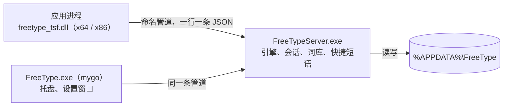

# Windows 版

FreeType 的 Windows 版由三部分组成：每个应用里加载的输入法 DLL、常驻的服务进程，以及用 mygo 写的托盘与设置程序。输入规则、词库和学习都复用 WowType 的 Rust 核心（`core/`）。

**状态：测试版 0.0.1。** 自动测试覆盖核心、服务进程、管道、DLL 加载和设置界面；在真实应用里打字的桌面验收尚未完成，见文末「验证范围」。

## 结构



- **输入法 DLL**（`windows/tsf`）：TSF 文本服务。把按键翻成键码交给服务进程，按应答组字、上屏，在光标下方画候选窗。服务进程连不上或 1.5 秒没应答时不吃键，应用照常收到按键。
- **服务进程**（`windows/server`）：只有一个，常驻引擎（加载词库需要 1.5–7 秒、几百 MB 内存，不能放进每个应用）。每条管道连接一个输入会话。
- **托盘与设置**（`windows/app`）：mygo v0.9.0 原生界面。开机以 `--background` 启动，只放托盘图标并确保服务进程在跑。
- **协议**（`windows/protocol`）：管道消息定义，DLL、服务进程共用；设置程序在 `windows/app/protocol.go` 里有同样的结构。

管道名为 `\\.\pipe\FreeType-<当前用户 SID>`。访问控制允许当前用户、SYSTEM 和应用容器读写，完整性标签为低，商店应用和浏览器沙箱里的输入法也能连上。

## 输入行为

| 操作 | 结果 |
| --- | --- |
| 单按 Shift | 切换中文 / 英文；切到英文时编辑区的字母原样上屏；候选窗短暂显示「中」或「英」 |
| 字母 | 中文状态下进入编辑区；大写锁定时原样交给应用 |
| 空格、数字 | 选当前候选 / 第几个候选 |
| 回车 | 编辑区的字母原样上屏 |
| 标点 | 没在组字：按全角规则转换；组字时：先上屏当前候选，再上屏标点 |
| `-` `=`、PgUp PgDn | 翻页 |
| 鼠标点候选、点 ‹ › | 选词、翻页 |
| Esc | 清空编辑区 |

其余规则（以词定字、V 模式计算器、日期时间、emoji 推荐、学习）与 WowType 的会话接口一致，见 [ABI.md](ABI.md) 和 [USAGE.md](USAGE.md)。语音、互译和云功能在 Windows 版暂不提供。

## 水杉输入法格式兼容

设置程序的「词库」「快捷短语」页可以导入、导出 [msime-windows](https://github.com/metasequoiaime/msime-windows) 的批量文件。实现只照公开的文件格式写在 `core/src/msime.rs`，没有使用水杉的代码或词库数据。

| 内容 | 每行格式 | 说明 |
| --- | --- | --- |
| 词库 | `词语<Tab>拼音[<Tab>权重]` | 拼音写成 `ni'hao`、`ni hao` 或 `nihao` 都可以；`#` 开头的行和 `---` 到 `...` 之间的 YAML 头跳过；权重空着或含 `=` 时取 10000 |
| 快捷短语 | `编码<Tab>短语[<Tab>权重]` | 编码只能是英文字母，不分大小写；短语里的换行、Tab、反斜杠写成 `\n`、`\t`、`\\`；权重默认 10，同一编码权重大的在前 |

- 导入的词库存为 `dicts\<名字>.txt`，参与组词和排序，不写进学到的用户词。
- 快捷短语在输入正好等于编码时排在候选第一位（对应水杉的「快捷短语混入候选」），可在设置里关闭。
- 导出的文件可以再导入水杉输入法。

与水杉的差异：

- 没有 Shift+K 的快捷短语前缀查询模式。
- 只写词语、不写拼音的行不会自动注音，导入时跳过并报告行号。
- 快捷短语文件里 `#` 开头的行当注释跳过；写了 Tab 但权重为空的行取默认权重（水杉对这两种行报错）。

## 用户数据

固定在 `%APPDATA%\FreeType`，覆盖安装和卸载都保留：

| 文件 | 内容 |
| --- | --- |
| `config.json` | 设置 |
| `quick_phrases.txt` | 快捷短语（水杉格式） |
| `dicts\*.txt` | 导入的词库（水杉格式） |
| `user.tsv`、`history.tsv` | 学到的词和输入习惯，每 30 秒及退出前保存 |

`%LOCALAPPDATA%\FreeType` 放词库快照缓存和日志 `logs\server.log`。

## 安装器

`output/release/FreeType-0.0.1-Setup.exe` 由 mygo 生成的 NSIS 安装器，按当前用户安装到 `%LOCALAPPDATA%\Programs\FreeType`。安装钩子见 `windows/app/installer.nsh`：

1. 升级前让旧的服务进程保存后退出，关闭托盘程序。
2. 弹出一次管理员授权，运行 `bin\FreeTypeServer.exe --register-tsf`：把 x64、x86 两份 DLL 和图标复制到 `Program Files\FreeType`、`Program Files (x86)\FreeType`，注册 COM 类和简体中文输入法配置，并在 `HKLM\SOFTWARE\FreeType` 记下服务进程位置。DLL 被占用时先改名，重启后删除旧文件。
3. 把 FreeType 加进当前用户的输入法列表，写入开机启动项，启动托盘程序。

取消管理员授权时安装器会提示，输入法不可用；再运行一次安装程序即可重试。卸载时反向执行：注销输入法、移出输入法列表、删除开机启动项，保留用户数据。

## 构建

需要：Windows 10/11 x64、Visual Studio 2022 或更新版本的 C++ 生成工具与 Windows SDK、Python 3.11 与 Pillow、Git。Rust 和 Go 1.27.3 可以放在 `.local\toolchains`（不入库），构建脚本优先使用那里的版本。

1. 生成词库数据（rime-ice + 词级语言模型，约 70 MB，放 `.local\data`）：

   ```bash
   git clone --depth 1 https://github.com/iDvel/rime-ice.git .local/data-src/rime-ice
   bash scripts/make-data.sh .local/data-src/rime-ice .local/data
   ```

   脚本调用 `python3`。Windows 上它可能是应用商店的占位程序，需要让 `python3` 指向真正的 Python。

2. 构建固定测试安装器：

   ```powershell
   powershell -ExecutionPolicy Bypass -File windows\build.ps1
   ```

   脚本先跑全部测试，再构建服务进程、两种架构的 DLL 和 mygo 程序，生成安装器、`.sha256` 和 `build-info.json`。`build-info.json` 记录内部构建号、源码树（`git write-tree` 的结果）、工具链版本、组件和数据的 SHA-256。mygo 首次打包会下载 NSIS 3.13 到 `%LOCALAPPDATA%\mygo` 并校验摘要。

单独运行测试：

```powershell
cargo test -p wowtype-core --no-default-features
cargo test -p freetype-protocol -p freetype-server -p freetype-tsf
cd windows\app; go vet ./...; go test ./...
```

`freetype-server` 的端到端测试会以独立实例名启动真的服务进程（环境变量 `FREETYPE_INSTANCE`），不影响正在使用的输入法。

## 验证范围

已自动验证：

- Rust 核心在 Windows 上的全部测试，以及水杉格式读写、导入词库参与候选。
- 服务进程：按键规则、中英切换、标点、按键预判缓存、设置、快捷短语与词库管理；经命名管道的端到端打字、导入和退出。
- 输入法 DLL：导出函数齐全；不注册直接载入时类工厂能建出文本服务，释放后可以卸载；按键翻译与单按 Shift 判定。
- 设置界面：在无窗口测试中切换开关、添加 / 删除快捷短语、导入词库并显示报告。

尚未验证（需要在测试机上安装后人工检查）：

- 安装器的管理员授权、TSF 注册、加入输入法列表和卸载。
- 在记事本、浏览器、Office、商店应用、管理员进程和 32 位应用里实际打字；候选窗位置与高 DPI 显示。
- 托盘菜单和设置窗口的实际显示。
